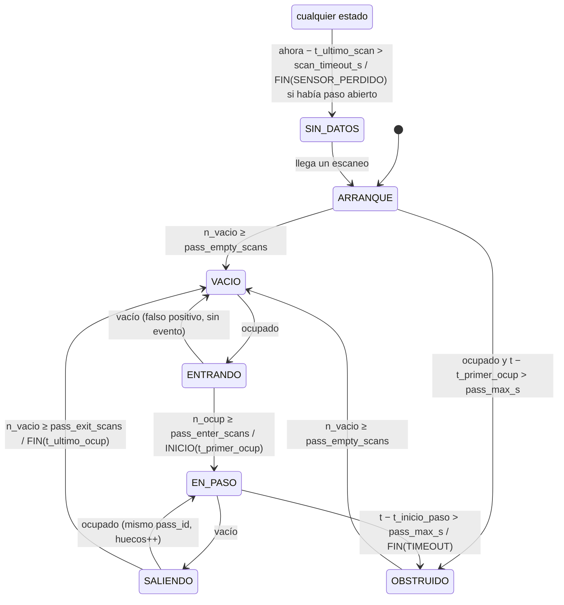

# Máquina de estados de paso (propuesta, sin implementar)

Convierte la detección por escaneo que ya hace `VelocityEstimator` (celdas ocupadas y
`object_extent`) en **pasos de camión** con inicio, fin, `pass_id` y banderas de calidad.
Estado: **diseño aprobado en estados y salidas (2026-10-20); pendiente implementar.**

## Supuestos de diseño

| Supuesto | Valor | Origen |
|---|---|---|
| Velocidad de paso esperada | **5–15 km/h = 1.39–4.17 m/s** | Equipo (2026-10-20) |
| Frecuencia de escaneo | 10 Hz (Δt = 0.1 s) | S2E medido: ~10.7 Hz |
| Largo de la ROI | 6.0 m (`roi_x_min_m = -3`, `roi_x_max_m = 3`) | `config/velocity.yaml` |
| Largo del camión | 7.5 m (simulador) … ~10 m (doble troque) | `sim/lidar_sim.py`; **medir** |
| Sentido de circulación | +x (entra por `x_min`, sale por `x_max`) | `core/geometry.py` |
| Un camión a la vez | sí | Acuerdos del MVP |

Tiempo de ocupación de la ROI: `T = (L_camión + L_roi) / v`
- A 15 km/h con 7.5 m: (7.5 + 6) / 4.17 ≈ **3.2 s** (≈ 32 escaneos).
- A 5 km/h con 10 m: (10 + 6) / 1.39 ≈ **11.5 s** (≈ 115 escaneos).
- Avance máximo por escaneo: 4.17 × 0.1 ≈ **0.42 m**.

## Estados

| Estado | Significado | `ready` (HMI) |
|---|---|---|
| `ARRANQUE` | Inicio o retorno de falla; no se sabe si hay un camión a medio pasar | no |
| `VACIO` | ROI libre, esperando vehículo | **sí** |
| `ENTRANDO` | Ocupación detectada, sin confirmar | sí |
| `EN_PASO` | Paso confirmado (`pass_id` asignado); se mide | sí |
| `SALIENDO` | ROI aparentemente libre; confirmando salida (o hueco momentáneo) | sí |
| `OBSTRUIDO` | Ocupación demasiado larga: objeto fijo, camión detenido o mala calibración | no |
| `SIN_DATOS` | No llegan escaneos del LiDAR | no |

## Entradas por escaneo y variables internas

Entradas (de `VelocityEstimator.process` y del reloj del nodo):
- `t`: stamp del escaneo; `ocupado`: `mask.sum() >= object_min_bins`;
  `ext = (x0, x1)`: `object_extent`; `est`: `VelocityEstimate` del escaneo.
- `ahora`: reloj del nodo (timer), para detectar `SIN_DATOS` aunque no lleguen escaneos.

Variables: `n_ocup` / `n_vacio` (escaneos consecutivos ocupados / vacíos), `t_primer_ocup`,
`t_ultimo_ocup`, `t_ultimo_scan`, `t_inicio_paso`, `pass_id`, `ext_inicial`, `ext_final`,
acumuladores de calidad (n escaneos, n OK, velocidades OK, n huecos, n reversa).

## Parámetros (modificables en `config/velocity.yaml`)

Siguiendo la convención del repo, se agregan a `VelocityParams` **y** al YAML (floats con punto).

| Parámetro | Defecto | Unidad | Justificación del valor inicial |
|---|---|---|---|
| `pass_enter_scans` | 3 | escaneos | Confirmar entrada en 0.3 s (= `WARMING_UP` actual con `baseline_scans = 3`, no agrega demora). A 15 km/h el frente avanza 1.25 m. |
| `pass_exit_scans` | 5 | escaneos | Tolera huecos de hasta 0.4 s (dropouts). Separa camiones si el espacio entre ellos supera `L_roi + v·0.5 s` ≈ 8.1 m a 15 km/h. |
| `pass_empty_scans` | 5 | escaneos | Escaneos vacíos para salir de `ARRANQUE` / `OBSTRUIDO`. |
| `pass_max_s` | 30.0 | s | ~2.6 × el peor caso (11.5 s). Por encima: `TIMEOUT` → `OBSTRUIDO`. Subir si se toleran paradas. |
| `scan_timeout_s` | 0.5 | s | ~5 escaneos perdidos → `SIN_DATOS`. |
| `pass_edge_margin_m` | 1.0 | m | Franja de borde para validar entrada/salida: avance por escaneo (0.42 m) + tamaño mínimo detectable (`object_min_bins · dx` = 0.5 m) + holgura. |
| `pass_v_min_mps` | 1.39 | m/s | 5 km/h. Mediana de v del paso por debajo (menos tolerancia) → bandera. |
| `pass_v_max_mps` | 4.17 | m/s | 15 km/h. Por encima (más tolerancia) → bandera. |
| `pass_v_tolerance_mps` | 0.3 | m/s | Holgura sobre el rango anterior. |
| `pass_reverse_v_mps` | -0.2 | m/s | Velocidad OK por debajo de esto cuenta como reversa. |
| `pass_reverse_scans` | 3 | escaneos | Escaneos de reversa (no necesariamente seguidos) para levantar la bandera. |
| `pass_min_valid_fraction` | 0.6 | — | Fracción mínima de escaneos `OK` dentro del paso. Provisional: hoy el simulador da 75–80 %. |

## Diagrama



Versión en texto:

```
                     n_vacio ≥ pass_empty_scans
   ┌──────────┐ ───────────────────────────────▶ ┌─────────┐
   │ ARRANQUE │                                  │  VACIO  │◀──────────────────────────┐
   └──────────┘ ── ocupado > pass_max_s ──┐      └─────────┘                           │
                                          │        │     ▲                             │
                                          │ ocupado│     │ vacío antes de confirmar    │
                                          │        ▼     │ (falso positivo, sin evento)│
                                          │      ┌──────────┐                          │
                                          │      │ ENTRANDO │                          │
                                          │      └──────────┘                          │
                                          │        │ n_ocup ≥ pass_enter_scans          │
                                          │        ▼ ⇒ INICIO (pass_id++, t_primer_ocup)│
                                          │      ┌──────────┐  vacío    ┌──────────┐   │
                                          │      │ EN_PASO  │ ────────▶ │ SALIENDO │───┘
                                          │      └──────────┘ ◀──────── └──────────┘ n_vacio ≥ pass_exit_scans
                                          │        │        ocupado (mismo id,         ⇒ FIN (t_ultimo_ocup)
                                          │        │        huecos++)
                                          ▼        │ t − t_inicio_paso > pass_max_s
                                     ┌───────────┐ │ ⇒ FIN (TIMEOUT)
                                     │ OBSTRUIDO │◀┘
                                     └───────────┘ ── n_vacio ≥ pass_empty_scans ──▶ VACIO

   Cualquier estado ── ahora − t_ultimo_scan > scan_timeout_s ──▶ SIN_DATOS
       (con paso abierto ⇒ FIN con SENSOR_PERDIDO)
   SIN_DATOS ── llega un escaneo ──▶ ARRANQUE
```

## Tabla de transiciones

Se evalúa una vez por escaneo (y `SIN_DATOS` también en un timer). Orden de prioridad:
`SIN_DATOS` primero, luego timeout, luego ocupación.

| # | Desde | Condición | Hacia | Acción |
|---|---|---|---|---|
| T1 | `ARRANQUE` | `n_vacio ≥ pass_empty_scans` | `VACIO` | — |
| T2 | `ARRANQUE` | `ocupado ∧ t − t_primer_ocup > pass_max_s` | `OBSTRUIDO` | — |
| T3 | `VACIO` | `ocupado` | `ENTRANDO` | `t_primer_ocup = t`, `ext_inicial = ext` |
| T4 | `ENTRANDO` | `¬ocupado` | `VACIO` | contador de falsos positivos++ |
| T5 | `ENTRANDO` | `n_ocup ≥ pass_enter_scans` | `EN_PASO` | `pass_id++`, `t_inicio_paso = t_primer_ocup`, evento **INICIO** |
| T6 | `EN_PASO` | `¬ocupado` | `SALIENDO` | — |
| T7 | `EN_PASO` | `t − t_inicio_paso > pass_max_s` | `OBSTRUIDO` | evento **FIN** con `TIMEOUT` |
| T8 | `SALIENDO` | `ocupado` | `EN_PASO` | `huecos++` (mismo `pass_id`) |
| T9 | `SALIENDO` | `n_vacio ≥ pass_exit_scans` | `VACIO` | evento **FIN** con `t_fin = t_ultimo_ocup`, `ext_final` = última extensión ocupada |
| T10 | `OBSTRUIDO` | `n_vacio ≥ pass_empty_scans` | `VACIO` | — |
| T11 | cualquiera | `ahora − t_ultimo_scan > scan_timeout_s` | `SIN_DATOS` | si había paso abierto: **FIN** con `SENSOR_PERDIDO` |
| T12 | `SIN_DATOS` | llega un escaneo | `ARRANQUE` | reinicia contadores |

En todo escaneo: si `ocupado` → `n_ocup++`, `n_vacio = 0`, `t_ultimo_ocup = t`; si no →
`n_vacio++`, `n_ocup = 0`. Desde `ARRANQUE` nunca se emite INICIO: un camión a medio pasar
no se mide (daría un volumen parcial sin aviso).

## Banderas de calidad del paso (se calculan en FIN)

| Bandera | Condición |
|---|---|
| `ENTRADA_FUERA_DE_BORDE` | `ext_inicial.x1 > roi_x_min_m + pass_edge_margin_m` (apareció en medio de la ROI) |
| `SALIDA_FUERA_DE_BORDE` | `ext_final.x0 < roi_x_max_m − pass_edge_margin_m` (desapareció sin cruzar el borde de salida) |
| `VELOCIDAD_FUERA_DE_RANGO` | mediana de v OK ∉ [`pass_v_min_mps` − tol, `pass_v_max_mps` + tol] |
| `REVERSA` | escaneos OK con `v < pass_reverse_v_mps` ≥ `pass_reverse_scans` |
| `POCOS_VALIDOS` | n OK / n escaneos del paso < `pass_min_valid_fraction` |
| `TIMEOUT` | cerrado por T7 |
| `SENSOR_PERDIDO` | cerrado por T11 |

Además se informa `huecos` (veces que pasó por `SALIENDO` y volvió). **Paso sin banderas =
candidato a medición válida** (criterio de aceptación: cada medición válida genera un registro).

## Salidas ROS

- `/pass_state` (cada escaneo): `state`, `state_text`, `pass_id`, `ready`.
- `/pass_event` (solo INICIO y FIN): mensaje nuevo `falconscan_interfaces/PassEvent` con
  `pass_id`, `event` (INICIO/FIN), `t_start`, `t_end`, `duration_s`, `flags`, `n_gaps`,
  `n_scans`, `n_valid`, `v_median_mps`, `v_min_mps`, `v_max_mps`.
- `pass_id` agregado a `VelocityEstimate.msg`.

## Implementación prevista

- `core/pass_tracker.py`: Python puro, sin ROS. `PassTracker.update(t, ocupado, ext, est)` y
  `PassTracker.tick(ahora)` → `(estado, eventos)`. Pruebas en `test/`.
- **Cambio aparte, a medir por separado:** hoy `VelocityEstimator.reset()` se llama en cada
  escaneo vacío. Con el tracker, el reinicio sería solo en FIN; en `SALIENDO` los escaneos vacíos
  se saltan sin borrar historial (la verificación `BAD_DT` existente acota huecos largos).
- Evaluación en simulación (ground truth de posición del camión): pasos perdidos, pasos
  fragmentados (un camión con dos `pass_id`), falsas entradas, error de `t_inicio`/`t_fin`.
  Escenarios: dropouts, persona cruzando, obstáculo fijo, camión que se detiene, dos camiones
  seguidos. **Los resultados del simulador no son evidencia de desempeño de campo.**

## Pendiente de decidir

1. Tolerancia a paradas del camión (hoy: `TIMEOUT` a los 30 s).
2. Si el cambio de `reset()` del estimador entra en la misma implementación o en un segundo paso.
3. Largo real de las volquetas (afecta `pass_max_s` y la separación mínima entre camiones).
