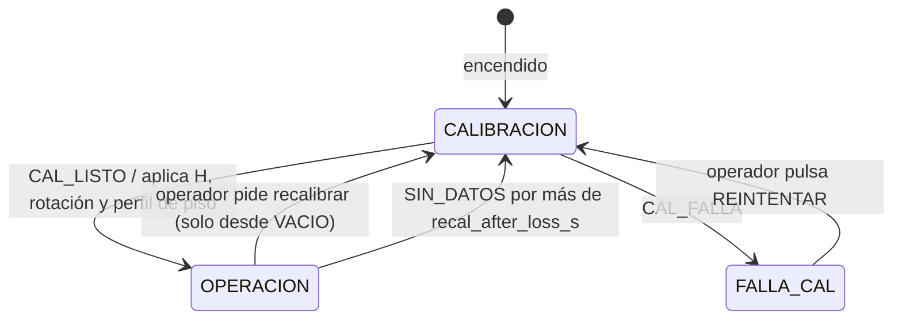
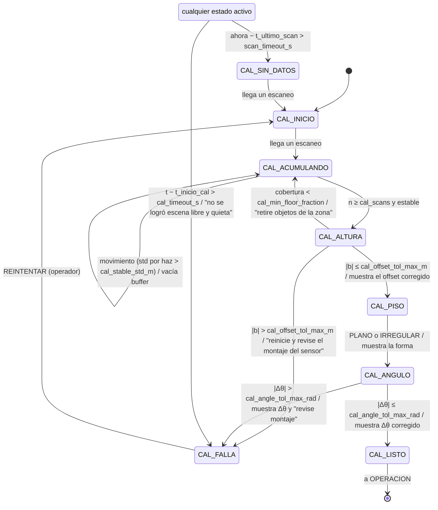
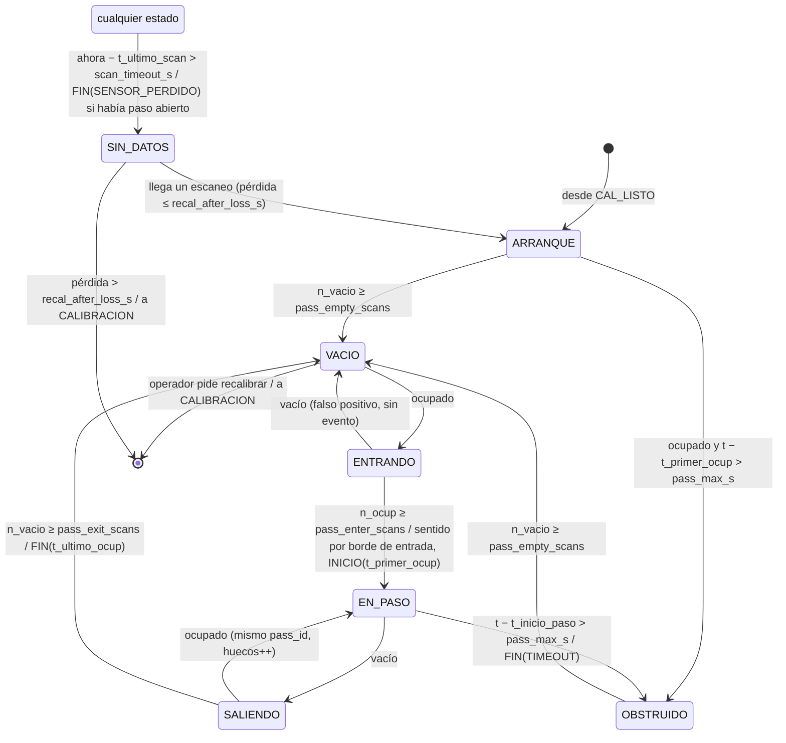

# Máquinas de estados: calibración y operación

El sistema funciona en dos fases, cada una con su propia máquina de estados:

1. **Calibración** (cada encendido): estima el offset de rango del sensor contra la altura
   medida por el instalador (`mount_height_m`), reconoce el patrón del piso y estima el desvío
   de la flecha de 0° respecto a la perpendicular al piso. Muestra cada paso en la HMI.
2. **Operación**: convierte la detección por escaneo de `VelocityEstimator` en **pasos de
   camión** con inicio, fin, `pass_id`, sentido y banderas de calidad. Es **bidireccional**:
   estima la rapidez de avance entre por el lado que entre el camión. Usa la geometría que dejó
   la calibración.

Estado:
- **2026-10-20:** máquina de operación aprobada en estados y salidas.
- **2026-10-21:** se agrega la máquina de calibración, se limita la velocidad de paso a
  **5–10 km/h** y la operación pasa a ser bidireccional. Las decisiones del usuario están en
  «Decisiones». **Diseño listo para implementar**, salvo los puntos de «Pendiente de decidir».
- **2026-10-21 (rama `calibracion-sensor-real`):** se actualiza con lo ya implementado. La
  máquina de operación está en el código y ya es bidireccional; la de calibración y el
  supervisor siguen sin implementar. Detalle en «Estado de implementación».
- **2026-10-21, más tarde:** el código se alinea con las decisiones de este documento:
  - regla de sentido de la propuesta y bandera `SENTIDO_INCONSISTENTE`;
  - rapidez de avance en los mensajes;
  - 5–10 km/h;
  - cambio de `reset()`, medido en simulación;
  - flecha 0° al piso como nominal, también en el simulador;
  - calibración con H fijo y ajuste del offset `b`.

### Estado de implementación

| Parte | Estado | Dónde |
|---|---|---|
| Máquina de operación (T1–T12, banderas, `pass_id`) | **Implementada** | `core/pass_tracker.py`, `test/test_pass_tracker.py` |
| Operación bidireccional con la regla de esta propuesta (sentido en T5, `v_avance`, `SENTIDO_INCONSISTENTE`) | **Implementada** | `core/pass_tracker.py` |
| Búsqueda de la correlación en ambos sentidos | **Implementada: simétrica** `[−6, 6]` m/s, medida en simulación | `config/velocity.yaml` (`v_min_mps: -6.0`) |
| Cambio de `reset()` del estimador | **Implementado y medido** | `core/pipeline.py` (`VelocityPipeline`), `tools/evaluate_passes.py` |
| Velocidad de paso 5–10 km/h (`pass_v_max_mps = 2.78`) | **Implementada** | `config/velocity.yaml`, `VelocityParams` |
| Salidas `/pass_state` y `/pass_event`; `direction` y `advance_mps` en `VelocityEstimate` | **Implementadas** | `velocity_node.py`, `falconscan_interfaces/msg/` |
| Flecha 0° al piso como nominal (`angle_offset_rad = +π/2`) | **Implementada**, también en el simulador (nadir en ROS 180°) | `config/velocity.yaml`, `sim/lidar_sim.py` |
| Pasos 1–3 de la calibración: H fijo, ajuste `(b, α)`, estados OK / CORREGIDO / FALLA, avisos | **Implementados como herramienta** del visor, no como máquina de encendido | `core/calibration.py`, pestaña «Calibración» |
| Tolerancias `cal_offset_tol_*`, `cal_angle_tol_*` | **Implementadas** | `VelocityParams`, `config/velocity.yaml` |
| Máquina de calibración (C1–C14), supervisor, `/calibration_state`, `/system_state`, `recal_after_loss_s` | Pendiente | — |
| Perfil de piso por celda `z_piso(x)`, clase PLANO / IRREGULAR, bandera `PISO_IRREGULAR` | Pendiente | `core/geometry.py`, `core/calibration.py` |

## Supervisor (nivel superior)

| Modo | Qué hace | `ready` (HMI) |
|---|---|---|
| `CALIBRACION` | Corre la máquina de calibración | no |
| `FALLA_CAL` | La calibración no pudo terminar; espera una acción del operador | no |
| `OPERACION` | Corre la máquina de operación con la geometría calibrada | según el estado de operación |



Desde operación solo se pasa a recalibrar cuando la ROI está `VACIO`, para no cortar un paso.
Si el sensor estuvo sin datos mucho tiempo (lo desconectaron o se reinició), se recalibra
porque pudieron moverlo.

---

## 1. Máquina de calibración

### Convenciones de instalación (decididas el 2026-10-21)

- **Altura de referencia:** el instalador mide con cuidado la distancia del piso al **centro
  óptico del S2E** y la escribe en `mount_height_m`. Ese valor se toma como verdadero; la
  calibración no lo cambia. La diferencia entre lo que el sensor mide y ese valor se atribuye
  al **offset de rango del sensor** (`range_bias_m`). La posición exacta del centro óptico se
  verifica en la hoja de datos del S2E.
- **Orientación del 0°:** la flecha de 0° que trae marcada el S2E se monta **siempre apuntando
  al piso**, perpendicular a él. Así el `angle_offset_rad` nominal es el mismo en todas las
  instalaciones, y la rotación que mide la calibración es directamente **cuánto se desvía la
  flecha de la perpendicular al piso**.
- **Ojo con el marco de ángulos (verificado el 2026-10-20 en la prueba de pared):** el driver
  `sllidar_ros2` (con `inverted:=false`) publica `ángulo_ROS = 180° − ángulo_marca`. La flecha
  de 0° del sensor es el **rayo ROS 180°**, no el ROS 0°. Con la flecha al piso, el rayo hacia
  abajo es ROS 180° y el offset nominal es
  `angle_offset_rad = −π/2 − angle_direction · π` (= **+π/2** con `angle_direction = 1`).
  `velocity.yaml` y `VelocityParams` ya usan +π/2. Antes tenían −π/2, que equivale a montar la
  **marca 180°** al piso. El simulador también publica con el nadir en ROS 180°, así que
  simulador y sensor real comparten la geometría nominal. El visor muestra los dos ángulos
  (ROS y marca) en «Rayo hacia abajo».
- **Referencia de la rotación:** se mide respecto al piso, no respecto a la vertical de la
  gravedad. Es lo que se busca, porque el camión rueda sobre ese piso. Con un solo plano de
  escaneo, un sensor girado y un piso con pendiente a lo largo de x se ven igual, y para medir
  el camión los dos se corrigen de la misma forma.

### Qué se calibra y cómo

Durante la calibración la zona debe estar **libre de vehículos**: el sensor solo ve piso.
Se acumulan `cal_scans` escaneos quietos y, para cada haz, se toma la mediana del rango.

Sobre los haces que caen en piso (selección robusta con RANSAC; umbral de inlier
`cal_floor_max_dev_m`) se ajusta el modelo del rango esperado a un piso a distancia
`H = mount_height_m`:

```
r_i = H / cos(θ_i − α) + b
```

con dos incógnitas:
- `b`: offset de rango del sensor.
- `α`: ángulo de la perpendicular al piso respecto a la flecha de 0°, medido en el marco ROS
  (`θ_i` son los ángulos del mensaje, con la flecha en `θ = π`; el modelo usa `θ_i − π − α`).
  Con la flecha bien montada, α = 0. En la marca del sensor el desvío tiene el signo
  contrario (`α_marca = −α`).

`b` es el offset **residual después** de la corrección de rango propia de la unidad
(`range_scale`, prueba de pared, D11): esa corrección es casi toda de escala (0.43 % · d) y no
se puede representar con un offset fijo, porque los haces oblicuos son más largos. Si se
quitara `range_scale`, la escala aparecería como offset en el nadir (≈ 2.1 cm a 5 m) y como
residuo creciente en los bordes.

El ajuste es por mínimos cuadrados con pérdida robusta. De ahí salen los tres resultados:

| Paso | Resultado | Cómo se obtiene |
|---|---|---|
| 1. Altura y offset | `b` (offset del sensor) | Del ajuste, con `H = mount_height_m` fijo. Se informa también `H_visto = H + b`: la altura que "ve" el sensor sin corregir |
| 2. Piso | Perfil `z_piso(x)` | Con `b` y `α` aplicados, residuos de los inliers respecto al piso ideal, suavizados en ventanas de `cal_floor_smooth_m` |
| 3. Ángulo | `Δθ = α` (desvío de la flecha) | Del mismo ajuste. Se aplica como `angle_offset_eff = −π/2 − angle_direction · (π + α)` |

`α` sale del mismo ajuste del paso 1, pero se valida y se muestra en el paso 3, después de
reconocer el piso. Si el piso es IRREGULAR, el ajuste se repite usando solo las celdas que
quedaron dentro de `cal_floor_flat_tol_m`, para que una joroba no se confunda con rotación.

### Lo que ya existe en el código (herramienta del visor)

`core/calibration.py` y la pestaña «Calibración» del visor implementan los pasos 1–3 con la
convención decidida. Todavía no son la máquina de encendido: los dispara el operador y no hay
estados C1–C14.

- `fit_floor` selecciona los haces de piso: RANSAC restringido por la altura de la cinta
  (±0.25 m) y por la inclinación (±25° del «abajo» aproximado), descarta los haces con
  incidencia más rasante que 65° y refina con mínimos cuadrados totales. Cubre C3–C4.
- `fit_floor_offset` ajusta `(ν, b)` en `r_i = H / cos(θ_i − ν) + b` con H fijo. Usa
  Gauss-Newton con dos rondas de rechazo a 3σ, y entrega σ de `b` y de `ν`. El desvío de la
  flecha es `α = ν − nominal` (en la marca del S2E se muestra `−α`).
- `calibrate_mount` usa la mediana de N escaneos y da estados OK / CORREGIDO / FALLA para el
  offset (`cal_offset_tol_*`) y la rotación (`cal_angle_tol_*`), con los mensajes de C5 y C8.
  Avisa de:
  - cobertura de la ROI;
  - planitud;
  - objeto dentro de la ROI;
  - movimiento durante la captura (dispersión > 3 cm por haz).

  Con la pendiente medida aparte, usa `H · cos s` y da la plomada.
- En el visor, con FALLA solo se puede volver a capturar. «Aplicar» usa los valores
  **efectivos** en «Prueba de paso» (`range_bias_eff`, `angle_offset_eff`, H de la cinta) y
  **no** escribe el yaml. «Aplicar y guardar ficha» guarda la ficha JSON en
  `~/Desktop/scan/calibraciones/` y, solo si la cinta cambió, ofrece actualizar `mount_height_m`.
- «Guardar en yaml» de «Prueba de paso» ya no escribe `angle_offset_rad`, porque el yaml
  guarda el nominal.

Pruebas en `test/test_calibration.py`, con escaneos sintéticos:
- offset de −6 a +15 cm recuperado con ±1.5 mm;
- desvío de la flecha recuperado con ±0.02°;
- FALLA con offset de 22 cm o desvío de 6°;
- piso plano en la ROI después de aplicar la calibración;
- pared cercana descartada, objeto en la ROI, movimiento, rayos sin retorno, plomada.

**Error de la cinta (medido con escaneos sintéticos).** Con H fijo, un error δ de la cinta no
queda como un offset limpio. El ajuste lo infla por ~1/cos de los haces oblicuos (`b ≈ −1.33 δ`)
y el piso queda levemente curvado:

| H | δ cinta | `b` | piso en la ROI tras corregir | α |
|---|---|---|---|---|
| 3 m | ±1 cm | ∓1.33 cm | centro ∓3.3 mm, borde ±0.4 mm | sin cambio |
| 3 m | ±2 cm | ∓2.66 cm | centro ∓6.5 mm, borde ±0.8 mm | sin cambio |
| 5 m | ±2 cm | ∓2.66 cm | centro ∓6.6 mm, borde ∓3.1 mm | sin cambio |

Frente al umbral de objeto de 0.4 m es despreciable, y la rotación no se afecta. Lo mismo pasa
con una pendiente del piso no medida: 4° equivale a 7.3 mm de diferencia perpendicular a 3 m.

### ¿Hace falta estimar el ángulo?

Para la **velocidad** su efecto es pequeño. Si el sensor está rotado δ, el camión parece
avanzar por una recta inclinada δ:
- El desplazamiento horizontal se escala por cos δ: con 1°, 0.015 %.
- El perfil sube o baja en bloque `s · sin δ`, y la correlación normalizada no es sensible a
  ese corrimiento.

Aun así, **sí es necesario**, por tres razones:
1. **Sin α, el offset sale mal.** Los haces oblicuos dependen mucho del ángulo. Con H = 5 m y
   el haz de borde a 30°, una rotación de 2° cambia el rango esperado en
   5/cos 32° − 5/cos 30° ≈ **12 cm**. Si el ajuste no estima α, esos 12 cm se confunden con
   offset o con un piso irregular.
2. **El piso aparece inclinado.** En el borde de la ROI (x = ±3 m), 1° de rotación equivale a
   ±5.2 cm de altura, y 3° a ±15.7 cm. Eso consume margen del umbral de objeto
   (`object_h_threshold_m` = 0.4 m) y hace que un piso plano se clasifique como IRREGULAR.
3. **Sirve de verificación del montaje.** Confirma que la flecha quedó perpendicular al piso y
   detecta, comparando con la calibración anterior, si el soporte se movió o se aflojó. No
   cuesta nada adicional: sale del mismo ajuste.

Por eso el valor calculado **se muestra siempre en pantalla**: en el paso 3, en el resumen de
`CAL_LISTO` y como dato fijo en la pantalla de operación.

La herramienta del visor ya hace este cálculo. Muestra el desvío de la flecha, su estado y a
qué altura se vería el piso en los bordes de la ROI sin corregirlo.

Sentido de giro del sensor: la flecha fija el 0° pero no el sentido de giro. Si el sensor se
monta volteado, el eje x queda espejado. **No hace falta detectarlo**, porque la operación es
bidireccional (ver «Sentido de circulación» en la sección 2): un eje espejado solo cambia el
lado por el que el sistema cree que entra el camión, y la rapidez de avance es la misma. El
perfil `z_piso(x)` se calcula en el mismo marco, así que queda espejado de forma consistente. El
signo de la rotación que se muestra depende de la cara de montaje; para verificar el montaje
importa su magnitud. En el visor, el paso «Sentido de avance» quedó **opcional**: solo orienta
el eje x, y el signo de la velocidad se cambia con la casilla «Invertir referencia».

### Estados

| Estado | Paso en la HMI | Qué hace |
|---|---|---|
| `CAL_INICIO` | "Iniciando calibración" | Espera el primer escaneo y reinicia el buffer |
| `CAL_ACUMULANDO` | "Leyendo piso (n/N)" | Acumula escaneos. Si la dispersión por haz supera `cal_stable_std_m` (algo se mueve), vacía el buffer y vuelve a empezar |
| `CAL_ALTURA` | Paso 1: "Verificando altura y offset del sensor" | Selección RANSAC y ajuste `(b, α)` con `H = mount_height_m`; revisa la cobertura y valida `b` |
| `CAL_PISO` | Paso 2: "Reconociendo piso" | Calcula los residuos y el perfil, y clasifica el piso (PLANO / IRREGULAR) |
| `CAL_ANGULO` | Paso 3: "Estimando rotación del sensor" | Valida `Δθ = α` y **lo muestra en pantalla** |
| `CAL_LISTO` | "Calibración completa" | Muestra el resumen (offset, piso, rotación), guarda el registro y pasa a `OPERACION` |
| `CAL_FALLA` | "Calibración fallida: <causa>" | Muestra la causa y la acción recomendada; espera REINTENTAR |
| `CAL_SIN_DATOS` | "Sin datos del LiDAR" | No llegan escaneos |

### Diagrama



Versión en texto:

```
  ┌────────────┐ escaneo ┌────────────────┐ n ≥ cal_scans ┌────────────┐
  │ CAL_INICIO │────────▶│ CAL_ACUMULANDO │──y estable───▶│ CAL_ALTURA │── |b| > máx ───┐
  └────────────┘         └────────────────┘               └────────────┘                │
        ▲                  │  ▲   ▲                        │  │                           │
        │      movimiento: │  │   └── cobertura baja ──────┘  │ |b| ≤ máx                 │
        │      vacía buffer└──┘       ("retire objetos")      ▼ (corrige offset b)        │
        │                                                 ┌──────────┐                    │
        │                                                 │ CAL_PISO │ PLANO / IRREGULAR  │
        │                                                 └──────────┘                    │
        │                                                      ▼                          │
        │                                                 ┌────────────┐                  │
        │                                                 │ CAL_ANGULO │── |Δθ| > máx ──┐ │
        │                                                 └────────────┘                │ │
        │                                                      │ |Δθ| ≤ máx (corrige θ)  ▼ ▼
        │                                                      ▼                  ┌───────────┐
        │                                                 ┌───────────┐           │ CAL_FALLA │
        │                                                 │ CAL_LISTO │──▶ OPERACION     └───────────┘
        │                                                 └───────────┘                 │
        └──────────────────────────── REINTENTAR (operador) ────────────────────────────┘

  Cualquier estado activo ── t − t_inicio_cal > cal_timeout_s ──▶ CAL_FALLA
  Cualquier estado ── ahora − t_ultimo_scan > scan_timeout_s ──▶ CAL_SIN_DATOS ── escaneo ──▶ CAL_INICIO
```

### Tabla de transiciones

| # | Desde | Condición | Hacia | Acción / mensaje en la HMI |
|---|---|---|---|---|
| C1 | `CAL_INICIO` | llega un escaneo | `CAL_ACUMULANDO` | `t_inicio_cal = t` (solo la primera vez del ciclo) |
| C2 | `CAL_ACUMULANDO` | std de rango por haz > `cal_stable_std_m` en más del 5 % de los haces | `CAL_ACUMULANDO` | vacía el buffer: "Movimiento en la zona, esperando…" |
| C3 | `CAL_ACUMULANDO` | `n ≥ cal_scans` | `CAL_ALTURA` | mediana por haz |
| C4 | `CAL_ALTURA` | fracción de celdas de la ROI con inliers < `cal_min_floor_fraction` | `CAL_ACUMULANDO` | "Zona ocupada o piso fuera de tolerancia: retire objetos" |
| C5 | `CAL_ALTURA` | `|b| > cal_offset_tol_max_m` | `CAL_FALLA` | "El sensor ve el piso a X.XX m y el parámetro es Y.YY m (offset Z cm). Reinicie y revise el montaje del sensor" |
| C6 | `CAL_ALTURA` | `|b| ≤ cal_offset_tol_max_m` | `CAL_PISO` | `range_bias_eff = b`; H se queda en `mount_height_m`. Si `|b| ≤ cal_offset_tol_ok_m`: "Altura OK (offset x cm)"; si no: "Offset del sensor corregido: x cm" |
| C7 | `CAL_PISO` | siempre | `CAL_ANGULO` | Si el residuo máximo ≤ `cal_floor_flat_tol_m`: PLANO, se usa la recta. Si no: IRREGULAR (advertencia), se usa `z_piso(x)`. Se informan RMS y desviación máxima |
| C8 | `CAL_ANGULO` | `|Δθ| > cal_angle_tol_max_rad` | `CAL_FALLA` | "La flecha de 0° está desviada x.x° de la perpendicular al piso: revise la fijación del sensor" |
| C9 | `CAL_ANGULO` | `|Δθ| ≤ cal_angle_tol_max_rad` | `CAL_LISTO` | `angle_offset_eff = −π/2 − angle_direction · (π + α)`. Si `|Δθ| ≤ cal_angle_tol_ok_rad`: "Rotación OK (x.x°)"; si no: "Rotación corregida: x.x°" |
| C10 | `CAL_LISTO` | siempre | `OPERACION` | guarda el registro de calibración y reconstruye el estimador con la geometría calibrada |
| C11 | cualquier estado activo | `t − t_inicio_cal > cal_timeout_s` | `CAL_FALLA` | "No se logró una escena libre y quieta" |
| C12 | cualquiera | `ahora − t_ultimo_scan > scan_timeout_s` | `CAL_SIN_DATOS` | — |
| C13 | `CAL_SIN_DATOS` | llega un escaneo | `CAL_INICIO` | — |
| C14 | `CAL_FALLA` | operador pulsa REINTENTAR | `CAL_INICIO` | reinicia `t_inicio_cal` |

`CAL_FALLA` solo ofrece REINTENTAR: no hay opción de "aceptar el valor medido". Si el problema
es el montaje o el parámetro, se corrige y se reintenta.

Cómo se usa la calibración en operación:
- `H` queda en `mount_height_m`, el valor medido por el instalador.
- `range_bias_m` y `angle_offset` pasan a ser los valores calibrados (`range_bias_eff = b`,
  `angle_offset_eff`).
- `height_profile` resta `z_piso(x)` celda por celda en lugar del `floor_z_m` constante.
- En las celdas donde la calibración no vio piso, se usa la recta ajustada (es un modelo, no
  un valor inventado). Ninguna celda se llena con 0.
- Los valores del YAML **no se sobrescriben**. Siguen siendo el valor nominal contra el que
  se compara en cada encendido.

### Parámetros de calibración

Se agregan a `config/velocity.yaml`, siguiendo la convención del repo (floats con punto
decimal, con prueba de correspondencia).

| Parámetro | Defecto | Unidad | Justificación del valor inicial |
|---|---|---|---|
| `cal_scans` | 30 | escaneos | 3 s a 10 Hz. La mediana de 30 baja el ruido de rango (~1.5 cm) a ~0.3 cm. |
| `cal_stable_std_m` | 0.05 | m | ~3 × el ruido de rango. Por encima, algo se mueve en la zona. |
| `cal_timeout_s` | 120.0 | s | Tiempo total para lograr una escena libre y quieta antes de declarar falla. |
| `cal_min_floor_fraction` | 0.7 | — | Fracción mínima de celdas de la ROI con piso visible. Por debajo hay un objeto o una sombra grande. |
| `cal_floor_max_dev_m` | 0.15 | m | Umbral de inlier de RANSAC = desviación máxima de piso aceptada. Deja margen frente a `object_h_threshold_m` (0.4 m). |
| `cal_floor_flat_tol_m` | 0.03 | m | Residuo máximo para llamar PLANO al piso (~2 × el ruido después de la mediana). |
| `cal_floor_smooth_m` | 0.20 | m | Ventana de suavizado del perfil `z_piso(x)` (10 celdas de 2 cm). |
| `cal_offset_tol_ok_m` | 0.03 | m | Del orden de la exactitud de rango del S2E (verificar en la hoja de datos). Por debajo se informa "OK"; igual se aplica. |
| `cal_offset_tol_max_m` | 0.20 | m | **Decidido (2026-10-21).** Por encima: reiniciar y revisar el montaje del sensor. |
| `cal_angle_tol_ok_rad` | 0.0087 | rad | 0.5°: en el borde de la ROI (x = 3 m) produce un error de altura de 2.6 cm. |
| `cal_angle_tol_max_rad` | 0.0873 | rad | 5°: con la flecha montada al piso, un desvío mayor indica un soporte flojo o mal instalado. |
| `recal_after_loss_s` | 30.0 | s | Pérdida de sensor tras la cual se recalibra antes de volver a operar. |

### Lo que muestra la HMI

Publicación en `/calibration_state`, con QoS *transient local* para que la HMI reciba el
último estado aunque se conecte tarde. Usa un mensaje nuevo,
`falconscan_interfaces/CalibrationState`:
- **Paso actual:** `step`, `step_text`, `progress` (0–1), `severity` (OK / CORREGIDO /
  ADVERTENCIA / FALLA), `message`.
- **Altura y offset:** `h_param_m` (`mount_height_m`), `h_seen_m` (= H + b),
  `sensor_offset_m` (b).
- **Ángulo:** `arrow_deviation_deg` (Δθ = α, desvío de la flecha de 0° respecto a la
  perpendicular al piso).
- **Piso:** `floor_class` (PLANO / IRREGULAR), `floor_rms_m`, `floor_max_dev_m`,
  `floor_coverage`.

Pantalla de calibración propuesta (Nextion), con el paso 3 ya calculado:

```
 ┌──────────────────────────────────────────────┐
 │  CALIBRACIÓN                     [no listo]  │
 │  ✔ Lectura de piso        30/30 escaneos     │
 │  ✔ Altura del sensor      param 5.00 m       │
 │        visto 5.04 m → offset +4 cm corregido │
 │  ⚠ Patrón de piso         IRREGULAR          │
 │        máx 6 cm, RMS 2 cm                    │
 │  ✔ Rotación del sensor    −0.8°  corregido   │
 │        (desvío de la flecha 0° vs. piso)     │
 │                                              │
 │  [ REINTENTAR ]   (solo visible en falla)    │
 └──────────────────────────────────────────────┘
```

En la pantalla de operación queda una línea fija con la calibración vigente, para que el valor
se vea siempre:

```
 Cal 2026-10-21 06:02 · offset +4 cm · rotación −0.8° · piso IRREGULAR
```

Registro: cada calibración se guarda en la SD (`calibracion_<fecha>.json`) con sus resultados.
Se compara con la anterior: si el offset cambió más de `cal_offset_tol_ok_m` o la rotación más
de `cal_angle_tol_ok_rad`, sale una advertencia: "el montaje cambió desde la última
calibración".

---

## 2. Máquina de operación (paso de camión)

Mantiene la lógica aprobada el 2026-10-20, ya implementada en `core/pass_tracker.py`. Cambian
tres cosas:
- el rango de velocidad pasa a **5–10 km/h** (los parámetros se recalcularon con ese rango);
- la máquina solo arranca después de una calibración exitosa;
- **es bidireccional**: el camión puede entrar por cualquiera de los dos lados.

Las de rango de velocidad y bidireccional ya están implementadas. Falta el supervisor, así que
hoy la máquina arranca sin esperar una calibración.

### Supuestos de diseño

| Supuesto | Valor | Origen |
|---|---|---|
| Velocidad de paso | **5–10 km/h = 1.39–2.78 m/s** | Equipo (2026-10-21). Se limita para favorecer el escaneo |
| Frecuencia de escaneo | 10 Hz (Δt = 0.1 s) | S2E unidad 1 medido: 10.01 Hz, σ Δt = 1.4 ms (prueba de pared, 2026-10-20) |
| Largo de la ROI | 6.0 m (`roi_x_min_m = -3`, `roi_x_max_m = 3`) | `config/velocity.yaml` |
| Largo del camión | 7.5 m (simulador) … ~10 m (doble troque) | `sim/lidar_sim.py`; **medir** |
| Sentido de circulación | **cualquiera** (+x o −x); se determina en cada paso | Equipo (2026-10-21) |
| Un camión a la vez | sí | Acuerdos del MVP |
| Geometría | `mount_height_m`, `range_bias_eff`, `angle_offset_eff`, `z_piso(x)` | Máquina de calibración |

Tiempo de ocupación de la ROI: `T = (L_camión + L_roi) / v`
- A 10 km/h con 7.5 m: (7.5 + 6) / 2.78 ≈ **4.9 s** (≈ 49 escaneos).
- A 5 km/h con 10 m: (10 + 6) / 1.39 ≈ **11.5 s** (≈ 115 escaneos).
- Avance máximo por escaneo: 2.78 × 0.1 ≈ **0.28 m**. Con 15 km/h era 0.42 m; el límite nuevo
  da más escaneos por metro de carga, que es lo que busca el LiDAR de volumen.

### Sentido de circulación (bidireccional)

Cada paso tiene un `sentido` fijo, +1 o −1, que se decide al confirmar la entrada (T5).
**Implementado así** en `core/pass_tracker.py`:

1. **Por el borde de entrada.**
   - Si `ext_inicial.x0 ≤ roi_x_min_m + pass_edge_margin_m`, el camión entró por `x_min` y
     `sentido = +1`.
   - Si `ext_inicial.x1 ≥ roi_x_max_m − pass_edge_margin_m`, entró por `x_max` y
     `sentido = −1`.
2. **Caso ambiguo:** el objeto apareció en medio de la ROI o ya tocaba los dos bordes. Se
   decide con el signo de la mediana de las primeras velocidades OK y se levanta la bandera
   `ENTRADA_FUERA_DE_BORDE`.
3. **Al cerrar el paso (FIN)** se compara el sentido con el signo de la mediana de v del paso.
   Si no coinciden, se levanta la bandera `SENTIDO_INCONSISTENTE`.

Con el sentido fijo se define la **rapidez de avance** de cada escaneo:
`v_avance = sentido · velocity_mps`.
- Es positiva cuando el camión avanza en su propio sentido y negativa si retrocede.
- **No es `|v|`**: si el camión se detiene y retrocede un poco, `|v|` sumaría ese retroceso como
  avance y el Δx del volumen saldría inflado.
- El LiDAR de volumen integra `Δx = sentido · displacement_m`, así que una reversa resta.

**Propuesta original de búsqueda:** pasarle el sentido al estimador para que la correlación
busque en `sentido · [v_min_mps, v_max_mps]`, con el mismo ancho que antes. Antes de conocer el
sentido, o en el caso ambiguo, buscar en el rango simétrico.

**Lo implementado (D13):** búsqueda **simétrica siempre**, `v_min_mps = −6.0` y
`v_max_mps = 6.0`. Con la búsqueda anterior, `[−0.5, 6.0]`, un camión hacia −x quedaba fuera del
rango y no daba ninguna velocidad válida. `tools/evaluate_sim.py` ahora incluye casos en
sentido contrario. Resultados (**simulador**, antes → después):

| Caso | Válidos | Sesgo | RMSE |
|---|---|---|---|
| +x, 0.3–5 m/s | sin cambio (87–88 % / 82 / 78 / 78 / 75 %) | sin cambio | sin cambio |
| −x, −1.5 / −3 / −5 m/s | 0 % → 73 / 71 / 67 % | +0.008 / +0.010 / +0.009 m/s | 0.026 / 0.017 / 0.026 m/s |
| frena 3 → 0.6 m/s | 73 → 92 % | −0.012 → −0.007 m/s | 0.024 → 0.023 m/s |
| cómputo | ~5 → ~7.7 ms/escaneo | | |

Duplicar las posiciones candidatas **no** aumentó los picos falsos en el simulador. Por eso no se
implementó la búsqueda según el sentido: el estimador tendría que conocer el estado de la máquina
y no hubo una mejora que medir. Queda como opción si los rosbag reales muestran picos falsos (ver
«Pendiente de decidir»). En −x hay algo menos de escaneos válidos que en +x porque la volqueta
simulada entra con la compuerta por delante y el perfil de entrada es distinto. Hay que
confirmarlo con rosbag reales.

Detalles de la implementación del sentido:
- Entrada ambigua: el sentido se decide con la mediana de las primeras 3 velocidades OK
  (`N_V_SENTIDO`). Mientras tanto `direction = 0`. El INICIO puede salir con 0, porque en T5 el
  estimador suele estar todavía en `WARMING_UP`.
- `PassTracker.direction` da el sentido del paso abierto en cualquier momento, para que el
  volumen integre `Δx` durante el paso.
- Si al cerrar no hay sentido (ninguna velocidad OK), se marcan `ENTRADA_FUERA_DE_BORDE` y
  `SALIDA_FUERA_DE_BORDE`.
- Con `pass_both_directions: false` el sentido es siempre +1. Solo cuenta el borde de `x_min`, y
  el sentido contrario queda con banderas.

*Referencia de signo.* Todo el núcleo trabaja en +x del marco mundo. Lo que se publica y se
muestra con signo (`velocity_mps`, `v_median_mps`, `direction`) lleva la referencia elegida por
el usuario, `invert_velocity_sign` (casilla «Invertir referencia» en el visor). Por defecto,
positivo = hacia +x. La **rapidez de avance** (`advance_*`) no depende de esa referencia.
Cambiarla no toca la geometría ni la ROI y no reinicia la máquina.

### Estados

| Estado | Significado | `ready` (HMI) |
|---|---|---|
| `ARRANQUE` | Entrada a operación o retorno de falla; no se sabe si hay un camión a medio pasar | no |
| `VACIO` | ROI libre, esperando vehículo | **sí** |
| `ENTRANDO` | Ocupación detectada, sin confirmar | sí |
| `EN_PASO` | Paso confirmado (`pass_id` asignado); se mide | sí |
| `SALIENDO` | ROI aparentemente libre; confirmando salida (o hueco momentáneo) | sí |
| `OBSTRUIDO` | Ocupación demasiado larga: objeto fijo, camión detenido o mala calibración | no |
| `SIN_DATOS` | No llegan escaneos del LiDAR | no |

### Entradas por escaneo y variables internas

Entradas (de `VelocityEstimator.process` y del reloj del nodo):
- `t`: stamp del escaneo.
- `ocupado`: `mask.sum() >= object_min_bins`.
- `ext = (x0, x1)`: `object_extent`.
- `est`: `VelocityEstimate` del escaneo.
- `ahora`: reloj del nodo (timer), para detectar `SIN_DATOS` aunque no lleguen escaneos.

Variables:
- Contadores: `n_ocup` / `n_vacio` (escaneos consecutivos ocupados / vacíos).
- Tiempos: `t_primer_ocup`, `t_ultimo_ocup`, `t_ultimo_scan`, `t_inicio_paso`.
- Paso: `pass_id`, `sentido`, `ext_inicial`, `ext_final`.
- Acumuladores de calidad: n escaneos, n OK, velocidades OK (con signo), n huecos, n reversa.

### Parámetros (modificables en `config/velocity.yaml`)

Se agregan a `VelocityParams` **y** al YAML (floats con punto decimal).

| Parámetro | Defecto | Unidad | Justificación del valor inicial (5–10 km/h) |
|---|---|---|---|
| `pass_enter_scans` | 3 | escaneos | Confirma la entrada en 0.3 s (= `WARMING_UP` actual con `baseline_scans = 3`, no agrega demora). A 10 km/h el frente avanza 0.83 m. |
| `pass_exit_scans` | 5 | escaneos | Tolera huecos de hasta 0.4 s (dropouts). Separa camiones si el espacio entre ellos supera `L_roi + v·0.5 s` ≈ 7.4 m a 10 km/h. |
| `pass_empty_scans` | 5 | escaneos | Escaneos vacíos para salir de `ARRANQUE` / `OBSTRUIDO`. |
| `pass_max_s` | 30.0 | s | ~2.6 × el peor caso (11.5 s, sin cambio). Por encima: `TIMEOUT` → `OBSTRUIDO`. |
| `scan_timeout_s` | 0.5 | s | ~5 escaneos perdidos → `SIN_DATOS`. Lo comparten las dos máquinas. |
| `pass_edge_margin_m` | 1.0 | m | Franja de borde para validar entrada/salida: avance por escaneo (0.28 m) + tamaño mínimo detectable (`object_min_bins · dx` = 0.5 m) + holgura. |
| `pass_v_min_mps` | 1.39 | m/s | 5 km/h. Mediana de `v_avance` del paso por debajo (menos tolerancia) → bandera. Vale para los dos sentidos. |
| `pass_v_max_mps` | **2.78** | m/s | **10 km/h** (antes 4.17). Mediana de `v_avance` por encima (más tolerancia) → bandera. |
| `pass_v_tolerance_mps` | 0.3 | m/s | Banda aceptada: 1.09–3.08 m/s ≈ 3.9–11.1 km/h. |
| `pass_reverse_v_mps` | -0.2 | m/s | Un escaneo OK con `v_avance` por debajo de esto cuenta como reversa (retroceso respecto al sentido del paso). |
| `pass_reverse_scans` | 3 | escaneos | Escaneos de reversa (no necesariamente seguidos) para levantar la bandera. |
| `pass_min_valid_fraction` | 0.6 | — | Fracción mínima de escaneos `OK` dentro del paso. Provisional: hoy el simulador da 75–80 % (67–73 % en −x). |
| `pass_both_directions` | true | — | **Implementado.** `false` = solo +x; el sentido contrario queda con banderas. |
| `invert_velocity_sign` | false | — | **Implementado.** Referencia de signo de lo publicado: `false` = positivo hacia +x. No cambia la lógica. |

Del estimador: `v_min_mps` pasó a **−6.0** (búsqueda simétrica, ver «Sentido de circulación») y
`v_max_mps` sigue en 6.0. Con 5–10 km/h, bajar los dos a ±4 m/s reduciría la ambigüedad del pico
y el cómputo, pero es otro cambio del algoritmo: va aparte y se mide con `tools/evaluate_sim.py`.

### Diagrama



Versión en texto:

```
     desde CAL_LISTO
          │          n_vacio ≥ pass_empty_scans
   ┌──────────┐ ───────────────────────────────▶ ┌─────────┐ ── operador: recalibrar ──▶ CALIBRACION
   │ ARRANQUE │                                  │  VACIO  │◀──────────────────────────┐
   └──────────┘ ── ocupado > pass_max_s ──┐      └─────────┘                           │
                                          │        │     ▲                             │
                                          │ ocupado│     │ vacío antes de confirmar    │
                                          │        ▼     │ (falso positivo, sin evento)│
                                          │      ┌──────────┐                          │
                                          │      │ ENTRANDO │                          │
                                          │      └──────────┘                          │
                                          │        │ n_ocup ≥ pass_enter_scans          │
                                          │        ▼ ⇒ INICIO (pass_id++, sentido ±1)   │
                                          │      ┌──────────┐  vacío    ┌──────────┐   │
                                          │      │ EN_PASO  │ ────────▶ │ SALIENDO │───┘
                                          │      └──────────┘ ◀──────── └──────────┘ n_vacio ≥ pass_exit_scans
                                          │        │        ocupado (mismo id,         ⇒ FIN (t_ultimo_ocup)
                                          │        │        huecos++)
                                          ▼        │ t − t_inicio_paso > pass_max_s
                                     ┌───────────┐ │ ⇒ FIN (TIMEOUT)
                                     │ OBSTRUIDO │◀┘
                                     └───────────┘ ── n_vacio ≥ pass_empty_scans ──▶ VACIO

   Cualquier estado ── ahora − t_ultimo_scan > scan_timeout_s ──▶ SIN_DATOS
       (con paso abierto ⇒ FIN con SENSOR_PERDIDO)
   SIN_DATOS ── llega un escaneo, pérdida ≤ recal_after_loss_s ──▶ ARRANQUE
   SIN_DATOS ── pérdida > recal_after_loss_s ──▶ CALIBRACION
```

### Tabla de transiciones

Se evalúa una vez por escaneo (y `SIN_DATOS` también en un timer). Orden de prioridad:
primero `SIN_DATOS`, luego timeout, luego ocupación.

| # | Desde | Condición | Hacia | Acción |
|---|---|---|---|---|
| T1 | `ARRANQUE` | `n_vacio ≥ pass_empty_scans` | `VACIO` | — |
| T2 | `ARRANQUE` | `ocupado ∧ t − t_primer_ocup > pass_max_s` | `OBSTRUIDO` | — |
| T3 | `VACIO` | `ocupado` | `ENTRANDO` | `t_primer_ocup = t`, `ext_inicial = ext`; estimador con búsqueda simétrica |
| T4 | `ENTRANDO` | `¬ocupado` | `VACIO` | contador de falsos positivos++ |
| T5 | `ENTRANDO` | `n_ocup ≥ pass_enter_scans` | `EN_PASO` | `pass_id++`, `t_inicio_paso = t_primer_ocup`, `sentido` por borde de entrada (o por las primeras 3 velocidades OK si es ambiguo), evento **INICIO**. La búsqueda del estimador es simétrica (no depende del sentido) |
| T6 | `EN_PASO` | `¬ocupado` | `SALIENDO` | — |
| T7 | `EN_PASO` | `t − t_inicio_paso > pass_max_s` | `OBSTRUIDO` | evento **FIN** con `TIMEOUT` |
| T8 | `SALIENDO` | `ocupado` | `EN_PASO` | `huecos++` (mismo `pass_id`) |
| T9 | `SALIENDO` | `n_vacio ≥ pass_exit_scans` | `VACIO` | evento **FIN** con `t_fin = t_ultimo_ocup`, `ext_final` = última extensión ocupada |
| T10 | `OBSTRUIDO` | `n_vacio ≥ pass_empty_scans` | `VACIO` | — |
| T11 | cualquiera | `ahora − t_ultimo_scan > scan_timeout_s` | `SIN_DATOS` | si había paso abierto: **FIN** con `SENSOR_PERDIDO` |
| T12 | `SIN_DATOS` | llega un escaneo, pérdida ≤ `recal_after_loss_s` | `ARRANQUE` | reinicia contadores |
| T13 | `SIN_DATOS` | pérdida > `recal_after_loss_s` | `CALIBRACION` | (nuevo) reinicia la calibración |
| T14 | `VACIO` | operador pide recalibrar | `CALIBRACION` | (nuevo) |

En cada escaneo: si `ocupado` → `n_ocup++`, `n_vacio = 0`, `t_ultimo_ocup = t`; si no →
`n_vacio++`, `n_ocup = 0`. Desde `ARRANQUE` nunca se emite INICIO: un camión a medio pasar
no se mide, porque daría un volumen parcial sin aviso.

### Banderas de calidad del paso (se calculan en FIN)

| Bandera | Condición |
|---|---|
| `ENTRADA_FUERA_DE_BORDE` | `ext_inicial` no toca ningún borde dentro de `pass_edge_margin_m`, o toca los dos (apareció en medio de la ROI o ya la cubría) |
| `SALIDA_FUERA_DE_BORDE` | desapareció sin cruzar el borde opuesto al de entrada: con `sentido = +1`, `ext_final.x0 < roi_x_max_m − pass_edge_margin_m`; con `sentido = −1`, `ext_final.x1 > roi_x_min_m + pass_edge_margin_m` |
| `VELOCIDAD_FUERA_DE_RANGO` | mediana de `v_avance` OK ∉ [`pass_v_min_mps` − tol, `pass_v_max_mps` + tol] = [3.9, 11.1] km/h |
| `REVERSA` | escaneos OK con `v_avance < pass_reverse_v_mps` ≥ `pass_reverse_scans` |
| `SENTIDO_INCONSISTENTE` | (nueva, valor 128) el signo de la mediana de v del paso no coincide con `sentido` (p. ej. entró y salió en reversa por el mismo lado) |
| `POCOS_VALIDOS` | n OK / n escaneos del paso < `pass_min_valid_fraction` |
| `TIMEOUT` | cerrado por T7 |
| `SENSOR_PERDIDO` | cerrado por T11 |
| `PISO_IRREGULAR` | (nueva, informativa, **sin implementar**: depende de la máquina de calibración) la calibración vigente clasificó el piso como IRREGULAR |

Además se informa `huecos`: veces que el paso entró en `SALIENDO` y volvió. **Un paso sin
banderas es candidato a medición válida** (criterio de aceptación: cada medición válida genera
un registro). `PISO_IRREGULAR` es informativa y no invalida el paso.

### Salidas ROS

**Implementadas en `velocity_node`:**
- `/pass_state` (`falconscan_interfaces/PassState`): `state`, `state_text`, `pass_id`,
  `pass_open`, `ready`. Se publica en cada escaneo. Sin escaneos, se publica cuando el estado
  cambia (timer cada `scan_timeout_s / 5`), para que la HMI vea `SIN_DATOS`.
- `/pass_event` (`falconscan_interfaces/PassEvent`, QoS confiable, profundidad 50), solo en
  INICIO y FIN, con:
  - `pass_id`, `event`, `valid`, `t_start`, `t_end`, `duration_s`;
  - `flags` (máscara con constantes `FLAG_*` = `PassFlag`) y `flag_names`;
  - `n_gaps`, `n_scans`, `n_valid`;
  - `v_median_mps`, `v_min_mps`, `v_max_mps` y `direction` (+1/−1/0), **con signo, en la
    referencia `invert_velocity_sign`**;
  - las extensiones inicial y final, en el marco mundo.
- `pass_id` en `VelocityEstimate.msg`: id del paso abierto (`EN_PASO`/`SALIENDO`), 0 fuera.
  Los escaneos de `ENTRANDO` salen con 0 aunque luego se confirme el paso; quien integre
  volumen debe incluir desde `PassEvent.t_start`. `velocity_mps`, `velocity_filtered_mps`,
  `displacement_m` y `shift_bins` van con signo en la misma referencia.
- `test/test_ros_msgs.py` verifica que las constantes de los mensajes coinciden con el núcleo
  y que la referencia invertida cambia los signos e intercambia mínimo y máximo.
- Probado con `velocity_node` y el simulador (que alterna sentidos con
  `alternate_direction:=true`): paso #1 con `direction = 1` y +1.49 m/s, paso #2 con
  `direction = −1` y −1.49 m/s, los dos válidos. Cortando el simulador a mitad de paso
  aparecen FIN con `SENSOR_PERDIDO` y `SIN_DATOS` publicado desde el timer.

- **Rapidez de avance** (implementada): `PassEvent.advance_median_mps`, `advance_min_mps` y
  `advance_max_mps` (`v_avance`, positiva en los dos sentidos), y en `VelocityEstimate` los campos
  `direction` (en la referencia de signo) y `advance_mps` (= sentido · v, NaN si no es válida).
  Para el volumen: `Δx = advance_mps · dt_s`. Se conservan además las velocidades con signo,
  a pedido del usuario.
- Probado de punta a punta (`velocity_node` y el simulador alternando sentidos): pasos con
  `direction` +1 / −1 desde el INICIO y avance 1.49 m/s en los dos.

**Pendientes de la propuesta:**
- `/system_state`: `mode` (CALIBRACION / FALLA_CAL / OPERACION) y `ready`.
- `/calibration_state`: ver la sección de calibración.
- La HMI muestra la rapidez de avance y el lado de entrada ("entrada A" o "entrada B").

---

## Implementación

Todo en Python puro dentro de `core/`, con pruebas. Los nodos solo convierten mensajes.

| Archivo | Contenido | Estado |
|---|---|---|
| `core/calibration.py` | `fit_floor` (selección RANSAC + TLS), `fit_floor_offset` (`(ν, b)` con H fijo), `calibrate_mount` (estados y avisos), `detect_direction` | **Implementado** (herramienta del visor). Falta el perfil `z_piso(x)` y la clase PLANO / IRREGULAR |
| `core/calibration.py` | `CalibrationRoutine.update(t, scan)` y `.tick(ahora)` → `(estado, resultado)` | Pendiente. Puede vivir junto a lo anterior en vez de en un `core/floor.py` aparte |
| `core/pass_tracker.py` | `PassTracker.update(t, ocupado, ext, est)` y `.tick(ahora)` → eventos; sentido por paso | **Implementado** |
| `core/pipeline.py` | `VelocityPipeline`: estimador + tracker con la política de `reset()`; lo usan el nodo, el visor y las pruebas | **Implementado** |
| `core/supervisor.py` | Modo del sistema; al terminar la calibración reconstruye `VelocityEstimator` con la geometría calibrada | Pendiente |
| `core/geometry.py` | `height_profile` acepta un piso por celda (arreglo) además del escalar `floor_z` | Pendiente |

Pruebas existentes: `test/test_pass_tracker.py` (transiciones, banderas, ambos sentidos,
referencia invertida y extremo a extremo con el simulador, incluidos dos camiones seguidos en
sentidos alternos), `test/test_calibration.py` (piso con pendiente y sensor girado, pared
cercana, cinta mal medida, objeto en la ROI, movimiento, rayos sin retorno, sentido),
`test/test_ros_msgs.py`. En total, 91 pruebas del paquete pasan.
`tools/evaluate_passes.py` evalúa la máquina con camiones seguidos en ambos sentidos: pasos
perdidos y fragmentados, sentido mal asignado y error de rapidez de avance.

Pruebas en simulación. El simulador necesita poder representar montaje con error (H y
rotación conocidos) y piso no plano (escalón, joroba, pendiente):
- **Calibración:** error de `b` y de `Δθ` frente a los valores verdaderos (offset y rotación
  simulados); que una joroba en el piso no se confunda con rotación; rechazo correcto con un
  objeto o una persona en la zona.
- **Operación:** pasos perdidos, pasos fragmentados (un camión con dos `pass_id`), falsas
  entradas, error de `t_inicio`/`t_fin`, sentido mal asignado. Escenarios: dropouts, persona
  cruzando, obstáculo fijo, camión que se detiene, dos camiones seguidos, velocidades de 5 y
  10 km/h, **cada uno en los dos sentidos**. El error de velocidad en −x debe ser el mismo que
  en +x. Hoy en simulación el sesgo es −0.009 m/s en +x y +0.009 m/s en −x a 1.5–5 m/s: en los dos
  sentidos la rapidez sale 0.2–0.6 % baja. Es el sesgo residual que ya figura como pendiente 2
  en `algoritmo_velocidad.md`, no un efecto del sentido.

**Los resultados del simulador no son evidencia de desempeño de campo.** La calibración se
valida después con el S2E real, midiendo H con cinta y la rotación con un nivel digital sobre
el soporte.

## Cambio de `reset()` del estimador (implementado)

Antes, `VelocityEstimator` borraba su historial en cada escaneo vacío. Ahora lo coordina
`VelocityPipeline` (`core/pipeline.py`):
- en `ENTRANDO`, `EN_PASO` y `SALIENDO`, los escaneos vacíos se saltan sin borrar el historial
  (`process(scan, keep_history=True)`), y la verificación `BAD_DT` acota los huecos largos;
- el estimador se reinicia al salir de esos estados: FIN, falsa entrada (T4) o pérdida del sensor;
- fuera de un paso se comporta como antes.

Medición (`tools/evaluate_passes.py`, **simulador**, 6 camiones alternando sentido por caso;
`--reset-on-empty` corre la política anterior):

| Caso | Pasos válidos, antes → ahora | Escaneos con v OK, antes → ahora | Fragmentados |
|---|---|---|---|
| 5 / 7.2 / 10 km/h, sin pérdidas | 6 → 6 | igual (79 / 76 / 75 %) | 0 |
| pérdida de rayos 15 % / 30 % | 5 → 5 / 0 → 0 | igual (63 / 50 %) | 0 |
| 5 % de escaneos ciegos | 5 → 6 | 66 → 76 % | 0 |
| 10 % de escaneos ciegos | 1 → 6 | 51 → 74 % | 0 |
| 20 % de escaneos ciegos | 0 → 6 | 36 → 74 % | 0 |
| 10 km/h, 10 % ciegos | 1 → 6 | 44 → 70 % | 0 |

«Escaneo ciego» = el camión no devuelve nada en ese escaneo (carrocería oscura o mojada) y solo
se ve el piso. Las pérdidas por rayo del simulador casi nunca vacían un escaneo entero, por eso
en esos casos no hay diferencia. Con 30 % de pérdida de rayos ningún paso es válido en las dos
políticas: `POCOS_VALIDOS` (50 % < `pass_min_valid_fraction` = 60 %).

## Decisiones

- **2026-10-20:** `pass_max_s = 30.0` s se mantiene. Es el tiempo máximo que un mismo paso
  puede estar abierto desde INICIO; al superarlo se cierra con `TIMEOUT` → `OBSTRUIDO`. Cubre
  también camiones detenidos (no se toleran paradas más largas). No depende de medir el largo
  real de las volquetas, aunque ese dato sigue sirviendo para la separación mínima entre
  camiones (`pass_exit_scans`).
- **2026-10-21:** velocidad de paso limitada a **5–10 km/h** para favorecer el escaneo;
  `pass_v_max_mps` = 2.78 m/s.
- **2026-10-21:** calibración obligatoria en cada encendido, antes de operar.
- **2026-10-21:** `mount_height_m` es la distancia piso → centro del sensor medida por el
  instalador y se toma como verdadera. La diferencia con lo que mide el sensor es el offset de
  rango (`range_bias_m`), que se corrige en cada calibración.
- **2026-10-21:** la rotación se mide respecto al piso (no a la vertical); es lo deseado.
- **2026-10-21:** la flecha de 0° del S2E se monta siempre apuntando al piso, perpendicular.
  Se estima y se muestra en pantalla su desvío.
- **2026-10-21:** offset > 20 cm → `CAL_FALLA`: "reinicie y revise el montaje del sensor".
  Solo REINTENTAR, sin opción de aceptar el valor medido.
- **2026-10-21:** el cambio de `reset()` va junto con la máquina de operación.
- **2026-10-21:** operación **bidireccional**. Se estima la rapidez de avance sin importar el
  lado de entrada. Con esto deja de importar el sentido de giro del sensor y no hace falta una
  segunda marca de instalación.
- **2026-10-21 (Juan Manuel):** la velocidad publicada lleva **signo** según el sentido, con una
  referencia elegible por el usuario (`invert_velocity_sign`, casilla en el visor). Implementado,
  junto con la rapidez de avance de la propuesta.
- **2026-10-21 (Juan Manuel):** alinear el código con las decisiones de este documento.
  Implementado (ver «Estado de implementación»).

## Pendiente de decidir

1. **Búsqueda de la correlación** (medido en simulación; ver «Sentido de circulación»). La
   búsqueda simétrica `[−6, 6]` m/s no empeoró ningún caso en +x y mide −x con 67–73 % de
   válidos. **Recomendación:** dejarla simétrica y revisar con los primeros rosbag reales si
   aparecen picos falsos (`AMBIGUOUS` o `IMPLAUSIBLE` de más). Solo entonces pasar a la búsqueda
   según el sentido. Con 5–10 km/h también se podría bajar a ±4 m/s; es otro cambio y se mide
   aparte.
2. **Máquina de calibración al encender y supervisor** (decidido que existan; falta
   implementarlos). La geometría (pasos 1–3) ya está en `core/calibration.py`. Faltan:
   - los estados C1–C14 con el timeout y REINTENTAR;
   - `/calibration_state` y `/system_state`;
   - `z_piso(x)` y la clase PLANO / IRREGULAR;
   - `recal_after_loss_s`;
   - que `velocity_node` use los valores efectivos. Hoy usa los nominales del yaml hasta que la
     calibración se aplique desde el visor, y eso solo afecta al visor.
3. Los umbrales de calibración (`cal_offset_tol_*`, `cal_angle_tol_*`, `cal_floor_*`) son
   provisionales hasta caracterizar el S2E real en el sitio.
