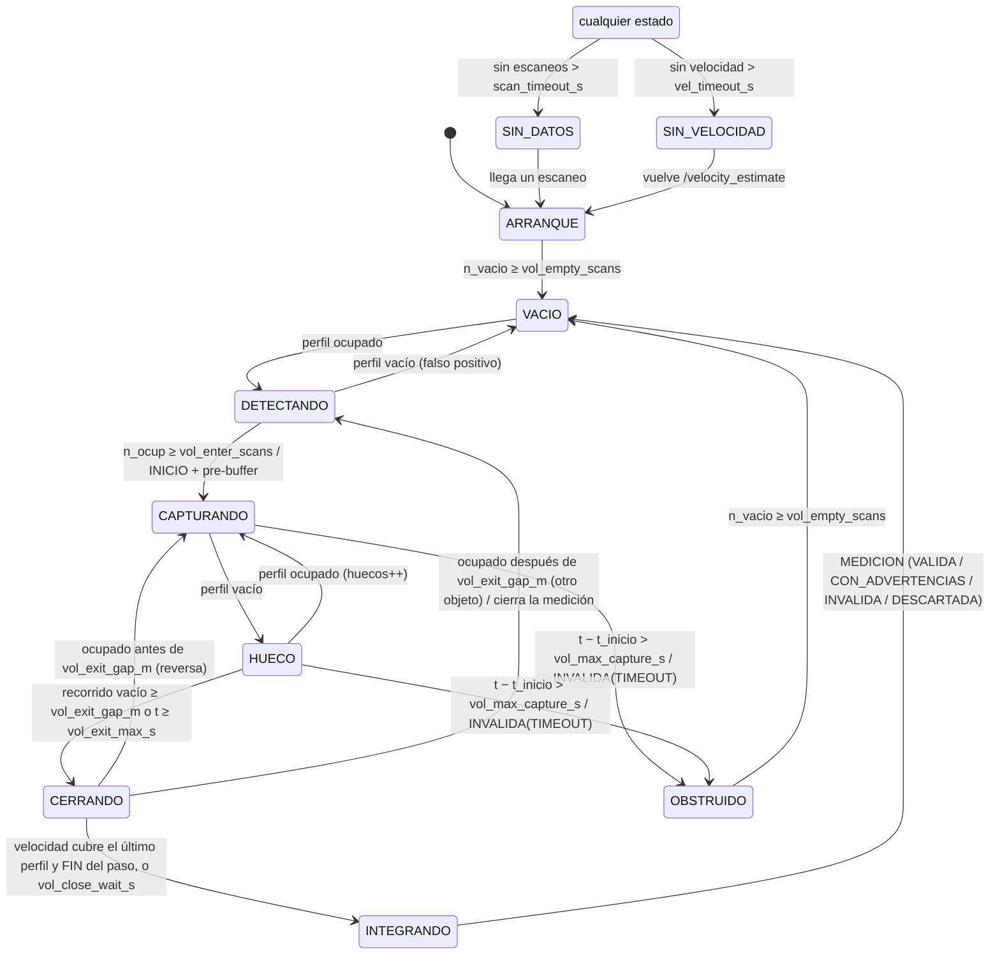
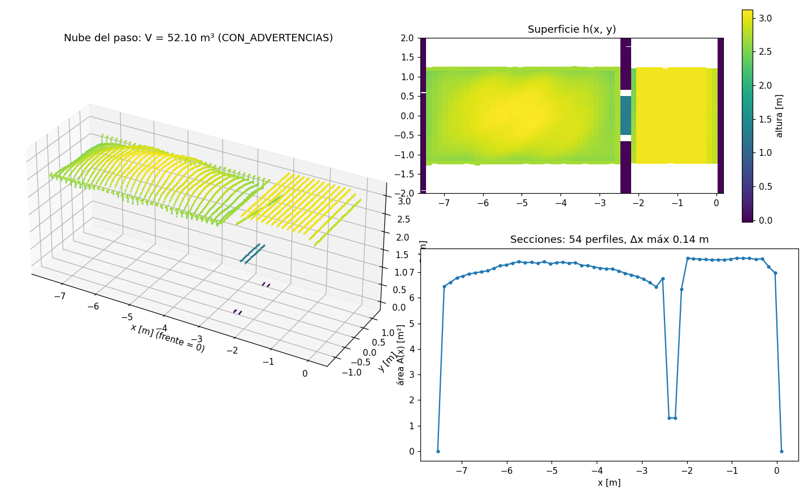

# Reconstructor de volumen: máquina de estados, algoritmo y resultados

Nodo `volume_node` (paquete `falconscan_volume`). Recibe los perfiles transversales del **LiDAR
de volumen** y la velocidad de avance del **LiDAR de velocidad**, y entrega por cada objeto que
cruza el plano de volumen:

1. **Reconstrucción visual:** nube de puntos 3D y malla de superficie del objeto (RViz, PLY).
2. **Volumen total de la envolvente:** V = ∫ A(x) dx, con A el área de cada sección
   transversal y x la posición de avance obtenida al integrar la velocidad.

Estado:
- **2026-10-24 (mañana):** propuesta de estados, transiciones, parámetros, chequeos y
  pseudocódigo para revisión.
- **2026-10-24 (tarde):** **implementado** con las decisiones del usuario (abajo), probado en
  el simulador 3D del pórtico (`tools/evaluate_volume_sim.py`) y en ROS con los dos LiDAR
  simulados. **Sin datos reales todavía.** La calibración dinámica (supervisor CAL_*) sigue
  pendiente: el nodo opera con la geometría del archivo de parámetros.

Decisiones del usuario (2026-10-24):
- Se implementa el `PassTracker` (hecho: `falconscan_velocity/core/pass_tracker.py`).
- Por ahora se calcula el **volumen de la envolvente entera**; la prioridad es probar la
  reconstrucción y la visualización. La separación y el volumen del volco van después.
- Paquete nuevo que **comparte calibración y archivo de parámetros** con velocidad:
  `config/falconscan.yaml` tiene las secciones `velocity_node` y `volume_node`, con los mismos
  nombres de montaje.
- **Frente y cola se ubican con el LiDAR de velocidad** (`vol_edge_from_velocity`).
- Parametrizables: desvío máximo del patrón transversal respecto al centro y respecto a la
  medida central (conducción no paralela → anula la medición), largo mínimo y máximo del
  objeto reconocible, sincronía entre LiDAR y la distancia del centro de rotación del LiDAR de
  velocidad al plano transversal (`vol_plane_offset_m`).
- La IP del segundo S2E se resuelve después.

---

## 0. Geometría y supuestos

### Marcos

```
                 vista superior (planta)
        y ▲
          │          plano de VELOCIDAD (x–z, en y = vel_plane_y_m ≈ 0)
   ───────┼───────────────────────────────────────────▶ x (avance)
          │                    ┃
          │                    ┃ plano de VOLUMEN (y–z, en x = vol_plane_offset_m)
          │                    ┃
              ROI de velocidad: x ∈ [−3, 3] m
```

- **Marco del pórtico:** x = eje de avance (el del LiDAR de velocidad), y = transversal
  (0 = eje del carril), z = vertical, z = 0 en el piso.
- **LiDAR de volumen:** plano y–z en `x = vol_plane_offset_m`. Usa la misma geometría que el
  LiDAR de velocidad (`MountGeometry`, `polar_to_xz`) con el eje horizontal en y
  (`y_offset_m` = posición lateral del sensor).
- **Marco del paso** (reconstrucción, frame `falconscan_paso`): x = 0 en el frente del objeto y
  negativo hacia la cola, y = izquierda del camión (`y_camión = sentido · y`), z = altura. La
  nube sale igual entre por donde entre el camión.

### Supuestos

| Supuesto | Valor | Origen |
|---|---|---|
| Sensor de volumen | RPLIDAR S2E, 10 Hz, ~3200 puntos/vuelta (≈ 0.11°); también A1 para banco | BOM. **Verificar** |
| Altura del sensor | ~5 m | **Medir** |
| Ancho de volqueta | ≤ 2.6 m | Límite legal; **verificar** |
| Velocidad de paso | 5–10 km/h (1.39–2.78 m/s) | Decisión 2026-10-21 |
| Separación entre perfiles | Δx = v / f = **0.14–0.28 m** | 10 Hz |
| Un camión a la vez | sí | Acuerdos del MVP |
| Relojes | Los dos drivers en el mismo PC → stamps con el mismo reloj | Verificar latencias (`sync_offset_s`) |

### Dónde va el plano de volumen

El estimador necesita `baseline_scans` escaneos y da ~20 % de AMBIGUOUS a la entrada y la
salida de la ROI. El plano de volumen debe estar **cerca del centro de la ROI de velocidad**
(`vol_plane_offset_m ∈ [−1.7, 1.7]` m; recomendado 0) para que el frente llegue con la velocidad
ya establecida y para que el LiDAR de velocidad vea el cruce del frente y de la cola.

Riesgo a revisar en campo: los dos S2E usan la misma longitud de onda y sus planos se cruzan en
una línea vertical; verificar que no haya diafonía.

### Qué afecta al volumen y qué no (Cavalieri)

Si un sólido rígido se traslada a través de un plano fijo, `V = ∫ A dx`, con x la componente del
desplazamiento normal al plano. La componente transversal no cambia el área de la sección.

| Situación | Efecto en V | Qué se hace |
|---|---|---|
| Camión **recto en diagonal** (ángulo ψ constante, avanza a lo largo de su eje) | Ninguno mientras no se trunque | **Ojo: no mueve el centro de la sección.** Todo punto del camión recorre la misma recta, así que en el plano fijo el eje cruza siempre por el mismo y. El chequeo de centro no lo detecta (ni le hace falta para el volumen). Sí deforma el perfil del LiDAR de velocidad: queda en «Pendientes» |
| **Giro o cambio de carril** bajo el pórtico | Pequeño en V; deforma la velocidad | El centro de la sección se mueve → `CONDUCCION_NO_PARALELA` (anula) |
| Camión descentrado | Ninguno si no se trunca | `DESCENTRADO` si el centro mediano pasa `vol_max_center_offset_m` (anula) |
| Camión fuera de la ROI lateral | **Subestima V** | `TRUNCADO_LATERAL` (anula) |
| Sesgo de velocidad ε | **ε en V (1:1)** | Se informa la cobertura; banderas de velocidad |
| Plano de volumen mal medido (`vol_plane_offset_m`) | Ninguno: desplaza todos los x por igual | Se pierde el ajuste de bordes por velocidad (`BORDES_SIN_VELOCIDAD`); si es grande, `DESINCRONIZADO` |
| Desfase de reloj δ entre LiDAR | Con v constante, ninguno; con aceleración a, ≈ a·δ/v | `DESINCRONIZADO` (anula) |
| Barrido del S2E durante la vuelta | Corte inclinado = cizalla: conserva el volumen | Cada punto se ubica con su propio instante |
| Escalones internos de la envolvente (cabina → chasís → volco) | El escalón cae en un punto al azar entre dos perfiles: error de media cero, σ ≈ 1 % a 10 km/h | Se reduce a la mitad a 5 km/h; no afectará al volumen de carga dentro del volco |
| Frente y cola | Con punto medio: σ = A·Δx/√12 por extremo (0.3 m³ a 10 km/h) | Se ubican con el LiDAR de velocidad (resolución 2 cm) |

---

## 1. Supervisor del nodo

| Modo | Qué hace | `ready` |
|---|---|---|
| `CALIBRACION` | (pendiente) Máquina de calibración de `docs/maquina_estados_paso.md` §1 sobre el eje y | no |
| `FALLA_CAL` | (pendiente) Espera REINTENTAR | no |
| `OPERACION` | Máquina de esta sección. **Hoy el nodo arranca directamente aquí** (`mode = "OPERACION"`) | según el estado |

`ready` del sistema (HMI) = `ready` de velocidad **y** `ready` de volumen.

---

## 2. Máquina de operación (`core/reconstructor.py`)

### Estados

| Estado | Significado | `ready` |
|---|---|---|
| `ARRANQUE` | Entrada a operación o vuelta de una falla; puede haber un objeto a medio pasar | no |
| `VACIO` | Plano libre; guarda el pre-buffer de perfiles | **sí** |
| `DETECTANDO` | Ocupación sin confirmar (filtra personas, polvo) | sí |
| `CAPTURANDO` | Objeto confirmado; acumula perfiles y publica la nube provisional | sí |
| `HUECO` | Plano vacío, pero el objeto no recorrió `vol_exit_gap_m` desde el último perfil ocupado | sí |
| `CERRANDO` | Salió; espera que la velocidad cubra el último perfil y el FIN del paso | sí |
| `INTEGRANDO` | Transitorio: posiciones, integración, chequeos, reconstrucción final | sí |
| `OBSTRUIDO` | Captura demasiado larga | no |
| `SIN_DATOS` | No llegan escaneos del LiDAR de volumen | no |
| `SIN_VELOCIDAD` | No llega `/velocity_estimate` (velocity_node publica uno por escaneo, haya objeto o no) | no |

Un escaneo **sin datos** (perdido o con menos de `vol_min_data_fraction` de celdas con dato) no
es un perfil vacío: no cambia contadores ni estados y deja un hueco en x que revisa
`HUECO_LONGITUDINAL`. Tratarlo como vacío ponía A = 0 en medio del camión (−6 % de volumen con
5 % de escaneos perdidos, en simulación).

### Diagrama



### Tabla de transiciones

Prioridad: `SIN_DATOS` → `SIN_VELOCIDAD` → timeout de captura → ocupación. Los números Vn están
en los comentarios del código.

| # | Desde | Condición | Hacia | Acción |
|---|---|---|---|---|
| V1 | `ARRANQUE` | `n_vacio ≥ vol_empty_scans` | `VACIO` | — |
| V2 | `VACIO` | ocupado | `DETECTANDO` | — |
| V3 | `DETECTANDO` | vacío | `VACIO` | falsos positivos++ |
| V4 | `DETECTANDO` | `n_ocup ≥ vol_enter_scans` | `CAPTURANDO` | `measurement_id++`; copia el pre-buffer (incluye ≥ 1 perfil vacío antes del frente); asocia el paso abierto; **INICIO** |
| V5 | `CAPTURANDO` | vacío | `HUECO` | `t_after` = primer vacío tras el último ocupado |
| V6 | `HUECO` | ocupado | `CAPTURANDO` | huecos++ |
| V7 | `HUECO` | recorrido vacío ≥ `vol_exit_gap_m` o `t − t_ultimo_ocup ≥ vol_exit_max_s` | `CERRANDO` | — |
| V8 | `CERRANDO` | velocidad OK con `mid_stamp ≥ t_after + vol_velocity_margin_s` **y** el paso asociado cerrado (o sin paso) | `INTEGRANDO` | — |
| V9 | `CERRANDO` | `ahora − t_cierre ≥ vol_close_wait_s` | `INTEGRANDO` | (si la velocidad no cubre: `VELOCIDAD_EXTRAPOLADA`) |
| V10 | `CERRANDO` | ocupado y recorrido < `vol_exit_gap_m` | `CAPTURANDO` | huecos++ (reversa) |
| V10b | `CERRANDO` | ocupado y recorrido ≥ `vol_exit_gap_m` | `DETECTANDO` | cierra esta medición; el perfil inicia la detección del siguiente objeto |
| V11 | `INTEGRANDO` | siempre | `VACIO` | **MEDICION** + nube final + superficie + exportación |
| V12 | `CAPTURANDO`/`HUECO` | `t − t_inicio > vol_max_capture_s` | `OBSTRUIDO` | **MEDICION** INVALIDA (`TIMEOUT`) |
| V13 | `OBSTRUIDO` | `n_vacio ≥ vol_empty_scans` | `VACIO` | — |
| V14 | cualquiera | `ahora − t_ultimo_scan > scan_timeout_s` | `SIN_DATOS` | captura abierta: INVALIDA (`SENSOR_PERDIDO`); en `CERRANDO` se integra normal |
| V15 | `SIN_DATOS` | llega un escaneo | `ARRANQUE` | (V16 «a CALIBRACION» cuando exista) |
| V17 | cualquiera | `ahora − t_ultima_vel > vel_timeout_s` | `SIN_VELOCIDAD` | captura abierta: INVALIDA (`SIN_VELOCIDAD`) |
| V18 | `SIN_VELOCIDAD` | llega `/velocity_estimate` | `ARRANQUE` | — |

Desde `ARRANQUE` nunca se emite INICIO: un objeto a medio pasar daría un volumen parcial.

### Cuándo empieza y cuándo termina

- **Empieza** (V4) cuando el **plano de volumen** confirma un objeto. Con el pre-buffer, el
  frente queda acotado entre un perfil vacío y uno ocupado.
- **Termina** (V7 → V8) cuando el plano estuvo vacío durante `vol_exit_gap_m` **de recorrido**
  (no de tiempo: un camión lento no debe cortarse en el espacio cabina–volco), la velocidad ya
  cubre el último perfil y el `PassTracker` cerró el paso (así se heredan sus banderas). Si algo
  de eso no llega, cierra igual a los `vol_close_wait_s`.
- El paso de velocidad (`/pass_event`) no abre ni cierra la captura: aporta `pass_id`, `sentido`
  y banderas (`PASO_*`).

---

## 3. Algoritmo y dónde se detecta cada falla

### 3.1 Perfil transversal (`core/section.py`, cada escaneo)

1. Rangos validados (inválido = NaN), sesgo de rango, mediana con NaN (núcleo de velocidad).
2. `(y, z)` con la geometría; malla lateral `vol_grid_dy_m`; por celda el **máximo** z.
3. Escaneo con menos de `vol_min_data_fraction` de celdas con dato → **sin dato**.
4. Objeto: celdas con `h > vol_h_threshold_m`, **unidas a través de huecos de NaN** (un rayo
   perdido al pie de una pared partía el objeto y dejaba fuera la pared del volco: −9 % de área
   en simulación). Un tramo cuenta si tiene ≥ `vol_object_min_run_m` sobre el umbral; ocupado si
   el ancho total ≥ `vol_object_min_width_m`.
5. NaN dentro del objeto: se interpolan entre alturas medidas; un tramo > `vol_max_nan_run_m`
   marca el perfil como `sombra`.
6. **Bordes con resolución de punto:** el borde lateral es el punto del objeto más externo más
   media separación entre puntos (la celda de borde contaba completa: +1 % de área por lado en
   una cabina). El área cuenta las celdas de borde solo hasta ese borde.
7. Instante del perfil = media de los instantes de los rayos que tocan el objeto.

| Chequeo por perfil | Detecta | Marca |
|---|---|---|
| Toca la ROI lateral ± `vol_edge_margin_m` | Parte del objeto fuera de vista | `truncated` |
| Tramo de NaN > `vol_max_nan_run_m` | Sombra no interpolable | `shadow` |
| Puntos sobre `vol_roi_z_max_m` encima del objeto | Carga más alta que la zona útil | `high` |
| Mediana de `h` en el piso visible a los lados fuera de ± `vol_floor_drift_tol_m` | El sensor se movió o la calibración ya no vale | `floor_drift` |

### 3.2 Posición x(t) (`core/odometry.py`)

- Se integra la velocidad OK en `mid_stamp`, lineal a trozos (exacta con aceleración
  constante). **No** se suma `displacement_m`: con `baseline_scans = 3` los intervalos se
  solapan.
- `x = sentido · ∫ v dt`: la reversa resta. El sentido es el del paso; si no hay, el signo de la
  mediana de v.
- Huecos de velocidad ≤ `vol_v_max_gap_s` se interpolan (marca); mayores dejan el perfil sin x
  (`VELOCIDAD_INSUFICIENTE`).
- **Bordes por velocidad:** el LiDAR de velocidad da la extensión del objeto en cada escaneo
  (referida a su `stamp`). El instante en que el frente (y la cola) cruza `vol_plane_offset_m`
  se interpola entre escaneos y se pasa a x.

### 3.3 Integración (`core/integration.py`)

1. Perfiles ordenados por x; los que quedan a menos de `vol_merge_dx_m` se fusionan (mediana):
   camión detenido o en reversa.
2. Objeto entre el último vacío antes del frente y el primero después de la cola; vacíos
   interiores con A = 0.
3. Trapecios sobre los perfiles ocupados.
4. Extremos: con el borde del LiDAR de velocidad (si cae entre el vacío y el ocupado que lo
   acotan), cara vertical hasta el borde (`edge_method = "velocidad"`); si no, punto medio.

### 3.4 Chequeos de la medición (`core/checks.py`)

**Centro transversal:** se usa el centro `(y0 + y1)/2` de los perfiles **estables**, cuyos dos
bordes coinciden (± 10 cm) con los de un vecino. Los perfiles de transición (el barrido cruza un
escalón: frente, fin de la cabina, inicio del volco, cola) ven un nivel de un lado y otro del
otro; su centro sale corrido ~0.37 m y daba falsas alarmas de paralelismo.

| Bandera | Condición | Tipo |
|---|---|---|
| `TRUNCADO_LATERAL` | fracción de perfiles `truncated` > `vol_max_truncated_fraction` | **anula** |
| `VELOCIDAD_INSUFICIENTE` | algún perfil del objeto sin x | **anula** |
| `HUECO_LONGITUDINAL` | algún Δx > `vol_max_dx_m` | **anula** |
| `SOMBRAS` | perfiles con sombra > `vol_max_shadow_fraction`, o celdas interpoladas > `vol_max_nan_fraction` | **anula** |
| `DESCENTRADO` | \|mediana del centro\| > `vol_max_center_offset_m` | **anula** |
| `CONDUCCION_NO_PARALELA` | máx \|centro − mediana\| > `vol_max_lateral_dev_m` | **anula** |
| `LARGO_FUERA_DE_RANGO` | largo > `vol_max_length_m` | **anula** |
| `POCOS_PERFILES` | perfiles ocupados < `vol_min_profiles` | **anula** |
| `DESINCRONIZADO` | \|Δt_sync\| > `vol_sync_tol_s` | **anula** |
| `INCOHERENCIA_LIDAR` | fracción de perfiles ocupados sin objeto en el plano según el LiDAR de velocidad > `vol_max_incoherent_fraction` | **anula** |
| `TIMEOUT` / `SENSOR_PERDIDO` / `SIN_VELOCIDAD` / `SIN_SENTIDO` | cierre anómalo | **anula** |
| `VELOCIDAD_INTERPOLADA` | fracción de perfiles con v interpolada > `vol_max_v_interp_fraction` | advertencia |
| `VELOCIDAD_EXTRAPOLADA` | la velocidad no cubrió la cola | advertencia |
| `BORDES_SIN_VELOCIDAD` | algún extremo con punto medio | advertencia |
| `SINCRONIA_NO_VERIFICADA` | no se observó el cruce en el LiDAR de velocidad | advertencia |
| `DERIVA_PISO`, `CARGA_ALTA`, `SIN_PASO` | ver §3.1 / sin paso asociado | advertencia |
| `PASO_*` | banderas heredadas del `PassTracker` | advertencia |

**Descarte (objeto no reconocible):** largo < `vol_min_length_m`, o largo desconocido con menos
de `vol_min_profiles` perfiles y sin paso de velocidad asociado (p. ej. una persona que solo
cruzó el plano). Resultado `DESCARTADA`: se publica pero no se exporta.

**Sincronía:** `Δt_sync` = instante del cruce visto por el LiDAR de velocidad − punto medio
entre los dos perfiles que lo acotan en el LiDAR de volumen (frente y cola, promediados). Por la
fase de los perfiles, en un solo paso vale hasta ±Δt/2 = ±0.05 s aunque todo esté bien. Un
error de posición del plano d da `d / v` (cambia con la velocidad); un desfase de reloj, un
valor fijo, que se corrige en `vol_time_offset_s`.

Resultado: `VALIDA` (sin banderas), `CON_ADVERTENCIAS`, `INVALIDA` o `DESCARTADA`.

---

## 4. Parámetros (`config/falconscan.yaml`, sección `volume_node`, 1:1 con `VolumeParams`)

| Parámetro | Defecto | Unidad | Justificación |
|---|---|---|---|
| `mount_height_m`, `angle_offset_rad`, `angle_direction`, `range_bias_m`, `range_scale`, `floor_z_m` | 5.0, +π/2, 1, 0, 1, 0 | — | Mismos nombres y fórmula que el LiDAR de velocidad: `r_corr = (r − range_bias_m)·range_scale`. +π/2 = flecha 0° del S2E al piso (rayo ROS 180°), también en el simulador del pórtico (D23). El yaml lleva los valores del sensor físico: unidad 1 en 192.168.11.2 con su prueba de pared (D22). **Medir con cinta y calibrar** (pestaña «Calibración», D24) |
| `y_offset_m` | 0.0 | m | Posición lateral del sensor respecto al eje del carril |
| `vol_plane_offset_m` | 0.0 | m | Distancia sobre x del centro de rotación del LiDAR de velocidad al plano transversal. Instalación del 2026-10-27: **0 cm**. La calibración (paso 4) la verifica con un objeto en el cruce de los planos |
| `vel_plane_y_m` | 0.0 | m | Posición lateral del plano de velocidad (informativo); la calibración (paso 4) la mide |
| `vol_time_offset_s` | 0.0 | s | Corrección de reloj/latencia; ajustar con `sync_offset_s` de varios pasos |
| `fan_angle_rad` / `fan_center_rad` | 2π / 0 | rad | Abanico de interés como en velocidad (D16, D25): rayos a más de la mitad de la apertura del centro (desde la vertical, + hacia +y) quedan NaN. Se ajusta en la calibración |
| `vol_roi_y_min_m` / `vol_roi_y_max_m` | −2.0 / 2.0 | m | Ancho ≤ 2.6 m + holgura de centrado |
| `vol_roi_z_max_m` | 4.5 | m | Por encima: pórtico |
| `vol_grid_dy_m` | 0.02 | m | ~2 × la resolución lateral |
| `vol_edge_margin_m` | 0.10 | m | Objeto más cerca del borde lateral → truncado |
| `vol_h_threshold_m` | 0.4 | m | Igual que velocidad |
| `vol_object_min_width_m` | 0.5 | m | Descarta personas de perfil, postes, aves |
| `vol_object_min_run_m` | 0.2 | m | Tramo continuo mínimo |
| `vol_max_nan_run_m` | 0.20 | m | Hueco interpolable dentro del objeto |
| `vol_floor_drift_tol_m` | 0.05 | m | ~3 × ruido |
| `vol_min_data_fraction` | 0.3 | — | Menos celdas con dato: escaneo sin dato |
| `vol_enter_scans` / `vol_preroll_scans` / `vol_empty_scans` | 2 / 4 / 5 | escaneos | Confirmación, pre-buffer (≥ 1 vacío antes del frente), salida de ARRANQUE |
| `vol_exit_gap_m` | 1.5 | m | Mayor que el espacio cabina–volco. **Medir volquetas** |
| `vol_exit_max_s` | 3.0 | s | Camión detenido justo después del plano |
| `vol_max_capture_s` | 30.0 | s | Igual que `pass_max_s` |
| `scan_timeout_s` / `vel_timeout_s` | 0.5 / 0.5 | s | ~5 escaneos / mensajes perdidos |
| `vol_velocity_margin_s` | 0.1 | s | La velocidad debe cubrir el último perfil + 1 escaneo |
| `vol_close_wait_s` | 3.0 | s | Espera máx. de la velocidad y del FIN del paso (la cola sale de la ROI ~1.6 s después a 5 km/h) |
| `vol_v_max_gap_s` | **1.0** | s | Hueco de velocidad interpolable. Con 0.5 s, los AMBIGUOUS del estimador invalidaban la mitad de los pasos (32/64, §7) |
| `vol_max_v_interp_fraction` | 0.3 | — | Advertencia |
| `vol_merge_dx_m` | 0.02 | m | Perfiles casi en el mismo x (camión detenido) |
| `vol_max_dx_m` | 0.6 | m | 2 × el avance máximo por escaneo + holgura |
| `vol_edge_from_velocity` | true | — | Frente y cola con el LiDAR de velocidad |
| `vol_min_profiles` | 10 | perfiles | Un objeto de 3 m a 10 km/h da ~11 |
| `vol_min_length_m` / `vol_max_length_m` | 3.0 / 20.0 | m | Objeto reconocible. **Ajustar** con la flota |
| `vol_max_truncated_fraction` | 0.05 | — | Espejos o extremos truncados tolerados |
| `vol_max_nan_fraction` / `vol_max_shadow_fraction` | 0.10 / 0.10 | — | Datos incompletos |
| `vol_max_center_offset_m` | 0.5 | m | Centro mediano (descentrado) → anula |
| `vol_max_lateral_dev_m` | 0.3 | m | Desvío del centro respecto a su mediana (conducción no paralela) → anula |
| `vol_sync_tol_s` | 0.15 | s | 1.5 escaneos; a 10 km/h, 0.42 m |
| `vol_max_incoherent_fraction` | 0.2 | — | Extremos donde la extensión de velocidad es dudosa |
| `vol_cloud_live` | true | — | Nube provisional durante la captura |
| `vol_export_dir` | "" | — | Carpeta (SD) para `.ply` + `.json` |
| `pass_frame_id` (solo nodo) | falconscan_paso | — | Frame de la nube y la superficie |

---

## 5. Salidas ROS

| Tópico | Tipo | QoS | Contenido |
|---|---|---|---|
| `/volume/state` | `VolumeState` | normal | `mode`, `state`, `ready`, `measurement_id`, `pass_id`, `n_profiles`, `partial_volume_m3` |
| `/volume/section` | `PointCloud2` (frame del LiDAR) | normal | Perfil transversal actual |
| `/volume/cloud` | `PointCloud2` (`falconscan_paso`) | transient local | Nube provisional en `CAPTURANDO`, final al cerrar; `intensity` = altura |
| `/volume/surface` | `Marker` TRIANGLE_LIST | transient local | Superficie de la medición final, coloreada por altura |
| `/volume/measurement` | `VolumeMeasurement` | transient local | Resultado, banderas, volumen, incertidumbre de extremos, largo, ancho, alto, centro, desvío, sincronía… |

Exportación (si `vol_export_dir` no está vacío): `medicion_<id>_<fecha>.ply` (CloudCompare,
MeshLab) y `.json` (medición + perfil de áreas A(x)).

El `velocity_node` publica además `/pass_state` y `/pass_event` (`PassEvent`, transient local),
y `VelocityEstimate` lleva `pass_id`, `direction` y `advance_mps`. Todo en el marco mundo del
LiDAR de velocidad: `invert_velocity_sign` es solo para mostrar (D20), así que `odometry.py`
integra `velocity_mps` sin ninguna referencia de signo de por medio.

---

## 6. Código

| Archivo | Contenido |
|---|---|
| `falconscan_volume/core/params.py` | `VolumeParams` |
| `core/section.py` | `SectionProcessor`: perfil transversal, área, bordes, marcas |
| `core/odometry.py` | `VelocityHistory`: x(t), huecos, cruce de bordes, extensión cercana |
| `core/integration.py` | Ordenar, fusionar, integrar, extremos |
| `core/checks.py` | Perfiles estables, trayectoria, sincronía, coherencia, banderas, clasificación |
| `core/reconstruction.py` | Nube y superficie en el marco del paso, triángulos, PLY/JSON |
| `core/reconstructor.py` | `VolumeReconstructor` (máquina de estados) |
| `sim/portico_sim.py` | Simulador 3D: volqueta como campo de alturas (volumen verdadero), trayectoria recta, diagonal o con cambio de carril, paradas; los dos LiDAR con barrido, ruido, pérdidas y error de reloj |
| `sim/scenario.py` | Cadena completa en simulación (`run_scenario`) |
| `volume_node.py` / `sim_portico.py` | Nodos ROS |
| `tools/evaluate_volume_sim.py` | Matriz de ensayos, repeticiones con fase uniforme, ablación (`--set`), gráfico (`--plot`) |

---

## 7. Resultados en simulación

`tools/evaluate_volume_sim.py --reps 8`: cadena completa (estimador + PassTracker →
reconstructor) sobre el simulador 3D. Cada caso se repite 8 veces con la fase de los perfiles
repartida uniformemente en un espaciado, medidas de la volqueta distintas (cabina ±0.2 m, volco
±0.4 m) y ruido distinto. Volqueta de referencia: 7.5 m, envolvente de 52.1 m³.

> **Simulación: no es evidencia de desempeño de campo.** La carga del simulador es lisa y sin
> materiales reales; los sensores no tienen los errores reales del S2E.

### Matriz final (2026-10-24, parámetros por defecto, velocidad estimada)

| Caso | Error medio | σ entre repeticiones | Resultado esperado | Obtenido |
|---|---|---|---|---|
| 5 km/h +x / −x | −0.56 % / −0.65 % | 0.46 % / 0.51 % | válida | 8/8 · 8/8 |
| 7.5 km/h +x / −x | −1.06 % / −1.02 % | 0.69 % / 0.91 % | válida | 8/8 · 8/8 |
| 10 km/h +x / −x | −1.04 % / −1.01 % | 0.99 % / 1.08 % | válida | 8/8 · 8/8 |
| Acelera 5→10 km/h / frena 10→5 km/h | −0.61 % / −0.90 % | 1.02 % / 0.49 % | válida | 8/8 · 8/8 |
| Se detiene 3 s bajo el pórtico | −0.71 % | 0.84 % | válida | 8/8 |
| Recta en diagonal 6° | −0.67 % | 0.60 % | válida (física, §0) | 8/8 |
| Cambio de carril 0.3 m | −1.13 % | 0.87 % | válida | 8/8 |
| Descentrado 0.4 m | −0.95 % | 0.85 % | válida | 8/8 |
| 5 % de escaneos perdidos | −1.08 % | 0.98 % | válida | 8/8 |
| 15 % de puntos perdidos / ruido de rango 3 cm | −1.25 % / −1.00 % | 1.17 % / 0.98 % | válida | 8/8 · 8/8 |
| Plano mal medido +0.3 m | −0.35 % | 1.08 % | válida con `BORDES_SIN_VELOCIDAD` | 8/8 |
| Cambio de carril 0.9 m | — | — | `CONDUCCION_NO_PARALELA` | 8/8 |
| Descentrado 0.6 m | — | — | `DESCENTRADO` | 8/8 |
| Fuera de la ROI lateral 1.0 m (−10.5 % de volumen) | — | — | `TRUNCADO_LATERAL` | 8/8 |
| Reloj desfasado 0.25 s | — | — | `DESINCRONIZADO` | 8/8 |
| Plano mal medido +1.0 m | — | — | `DESINCRONIZADO` | 8/8 |
| Persona cruzando el plano | — | — | DESCARTADA | 8/8 |
| Volco de 20 m (largo 22.5 m) | — | — | `LARGO_FUERA_DE_RANGO` | 8/8 |

**Casos válidos: 128/128 aceptados; error medio −0.87 %, |error| máximo 2.75 %, σ 0.91 %.**
Referencia: criterio de aceptación ≤ 8 % de error y ≤ 5 % de repetibilidad (para el volumen de
material y con datos reales).

De dónde sale el error (10 km/h, 8 repeticiones):
- Con la velocidad VERDADERA del simulador: −0.63 % (σ 1.08 %). La diferencia con la velocidad
  estimada (−1.0 %) es el sesgo conocido del estimador (pendiente 2 de `algoritmo_velocidad.md`).
- El resto del −0.6 % está a 1.6σ de cero con 8 repeticiones: no es concluyente.
- La dispersión es casi toda de los escalones internos de la envolvente (crece con Δx).

### Variantes medidas (8 casos de velocidad × 8 repeticiones)

| Variante | Aceptadas | Error medio | σ | Decisión |
|---|---|---|---|---|
| **Por defecto** (bordes por velocidad, `vol_v_max_gap_s = 1.0`) | 64/64 | −0.86 % | **0.83 %** | — |
| Extremos por punto medio (`vol_edge_from_velocity = false`) | 64/64 | −0.51 % | 1.24 % (1.6 % a 10 km/h) | Bordes por velocidad: menor dispersión |
| `vol_v_max_gap_s = 0.5` | **32/64** | — | — | 1.0 s: con 0.5 s los AMBIGUOUS del estimador invalidan la mitad de los pasos |

Notas de la medición:
- Una primera comparación favorecía al punto medio porque la volqueta medía 7.5 m, exactamente
  27 espaciados a 10 km/h, y los errores de frente y cola se cancelaban. Por eso las medidas
  cambian en cada repetición.
- La extensión del objeto del LiDAR de velocidad (`object_extent`) se cambió a centros de celda;
  con bordes de celda el largo salía ~2 cm más largo (+0.3 % de volumen).

### Reconstrucción



Nube del paso (izquierda), superficie h(x, y) (arriba a la derecha) y perfil de áreas A(x)
(abajo a la derecha): cabina, hueco con el chasís y volco con el montículo de carga.

### En ROS (simulación de los dos LiDAR)

`volume_sim.launch.py` a 7.5 y 10 km/h, sentido alterno: cada paso del PassTracker se asocia a
su medición (paso n ↔ medición n), la medición sale ~10 ms después del FIN del paso, VALIDA, con
50.9–52.1 m³ y L = 7.46–7.50 m. Nube (~6700 puntos) y superficie (~4400 triángulos) en el frame
`falconscan_paso`. El simulador genera cada escaneo en ~35 ms (PC sin carga).

Dos errores de relojes encontrados en esta prueba (corregidos): el PassTracker y la espera de
cierre comparaban el reloj del nodo con el stamp del escaneo. Con un driver con latencia (o el
simulador atrasado) el tracker se quedaba en SIN_DATOS y la medición cerraba antes del FIN.
Ahora los dos usan la hora de llegada.

---

## 8. Cómo probar

```bash
colcon build --symlink-install && source install/setup.bash
# Todo simulado + RViz (nube en vivo, superficie final, perfil transversal)
ros2 launch falconscan_volume volume_sim.launch.py speed_kmh:=7.5 direction:=0
ros2 launch falconscan_volume volume_sim.launch.py lane_shift_m:=0.9     # conducción no paralela
ros2 topic echo /volume/measurement
# LiDAR de volumen real (banco con el A1, o S2E) + volume_node; velocity_node aparte
ros2 launch falconscan_volume volume_lidar.launch.py lidar:=a1 rviz:=true
# Pórtico real completo
ros2 launch falconscan_volume portico.launch.py          # velocidad 192.168.8.8, volumen 192.168.11.2 (D22)
# Visor (pestaña «Volumen 3D»): mismo núcleo dentro del GUI, con nube y superficie 3D, vista
# superior, A(x), perfil transversal y tabla de mediciones. Fuentes: escenarios del simulador
# (los de tools/evaluate_volume_sim.py, generados una vez y en caché), ROS en vivo o rosbag.
tools/visor_lidar/visor_lidar.sh
python3 tools/visor_lidar/sim_volumen.py --caso "10 km/h +x" --salida /tmp/paso.npz   # generar sin GUI
```

Calibración de los dos LiDAR (D24): pestaña «Calibración» del visor. «▶ Encender LiDAR» lanza los
dos drivers (los mismos tópicos que `portico.launch.py`); con el piso vacío calibra los dos a la
vez, orienta cada plano con un objeto y mide la relación entre ellos con un poste en el cruce de
los planos. «Aplicar» deja los valores efectivos en «Volumen 3D» (fuente ROS o rosbag).

`volume_sim.launch.py` aplica a `velocity_node` los `SIM_VELOCITY_OVERRIDES` de
`falconscan_velocity/sim`: el yaml es el del sensor físico (H de la cinta, rayos invertidos de
sllidar_ros2, calibración de rango de la unidad 1). El simulador 3D publica el escaneo de
velocidad con el nadir en ROS 180° (`vel_nadir_angle_deg`), igual que el S2E con la flecha 0°
al piso, para que valga la geometría nominal del yaml (`angle_offset_rad = +π/2`).

---

## 9. Pendientes

1. **Datos reales.** Nada de lo anterior está validado en campo. Siguiente: los dos LiDAR
   conectados (IP del 2.º S2E), rosbag de pasos reales y un **objeto patrón de volumen conocido**.
2. **Calibración** (máquina CAL_* compartida con velocidad) y supervisor.
3. **Volumen de material:** segmentar el volco en la nube (paredes, borde superior) y restar la
   tara geométrica.
4. **Camión recto en diagonal:** no lo detecta el chequeo de centro (física, §0). Se podría
   estimar ψ con la inclinación de las caras (frente, cola, paredes del volco) en la superficie
   h(x, y). Antes, medir cuánto afecta ψ al LiDAR de velocidad (pendiente 1 de
   `algoritmo_velocidad.md`).
5. **Escalones internos de la envolvente** (σ ≈ 1 % a 10 km/h): se podría interpolar A(x) entre
   perfiles con la forma h(x) que ve el LiDAR de velocidad. Variante a medir.
6. **Huecos de velocidad**: el estimador da AMBIGUOUS sobre la carga lisa del simulador; con
   carga real puede ser distinto. Revisar con rosbag antes de ajustar `vol_v_max_gap_s`.
7. Umbrales provisionales (`vol_exit_gap_m`, largos, `vol_max_lateral_dev_m`,
   `vol_max_center_offset_m`) hasta medir la flota y el sitio.
8. Rendimiento en la Raspberry Pi 5: el perfil transversal cuesta ~1 ms en un PC; la superficie
   para RViz (miles de triángulos en Python) es lo más pesado y solo ocurre al cerrar.
